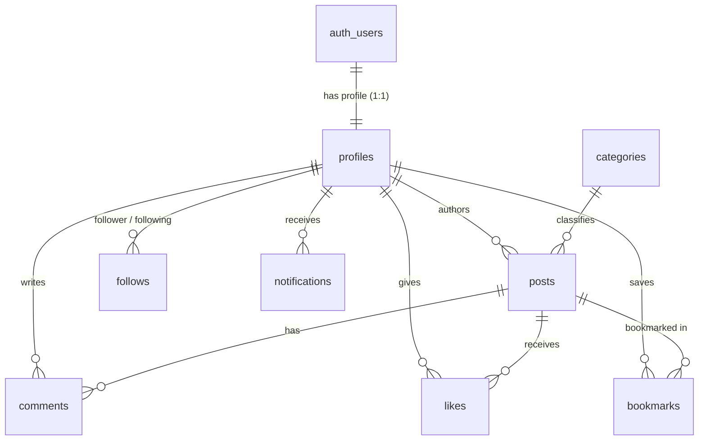

# WriteSpace Database Schema & RLS Policies 🗄️

This document specifies the PostgreSQL relational schema, constraints, indexes, triggers, and Row Level Security (RLS) policies implemented on the **InsForge PostgreSQL** instance.

---

## 1. Entity-Relationship Overview



---

## 2. Table Definitions

### 2.1 `profiles`
Stores extended user profile information linked to the authenticated user identity in `auth.users`.

```sql
CREATE TABLE public.profiles (
    id UUID PRIMARY KEY REFERENCES auth.users(id) ON DELETE CASCADE,
    username VARCHAR(50) UNIQUE NOT NULL,
    full_name VARCHAR(100) NOT NULL,
    bio TEXT,
    avatar_url TEXT,
    website VARCHAR(255),
    followers_count INT NOT NULL DEFAULT 0 CHECK (followers_count >= 0),
    following_count INT NOT NULL DEFAULT 0 CHECK (following_count >= 0),
    articles_count INT NOT NULL DEFAULT 0 CHECK (articles_count >= 0),
    created_at TIMESTAMPTZ NOT NULL DEFAULT timezone('utc'::text, now()),
    updated_at TIMESTAMPTZ NOT NULL DEFAULT timezone('utc'::text, now()),
    CONSTRAINT username_format CHECK (username ~* '^[a-zA-Z0-9_]{3,30}$')
);

-- Indexing
CREATE INDEX idx_profiles_username ON public.profiles(username);
CREATE INDEX idx_profiles_created_at ON public.profiles(created_at DESC);
```

---

### 2.2 `categories`
Stores curated topical categories for article discovery (e.g., Technology, Design, Culture, Science).

```sql
CREATE TABLE public.categories (
    id UUID PRIMARY KEY DEFAULT gen_random_uuid(),
    name VARCHAR(50) UNIQUE NOT NULL,
    slug VARCHAR(60) UNIQUE NOT NULL,
    description TEXT,
    icon VARCHAR(50),
    created_at TIMESTAMPTZ NOT NULL DEFAULT timezone('utc'::text, now())
);

-- Indexing
CREATE INDEX idx_categories_slug ON public.categories(slug);
```

---

### 2.3 `posts`
Stores published stories and private drafts created by authors.

```sql
CREATE TABLE public.posts (
    id UUID PRIMARY KEY DEFAULT gen_random_uuid(),
    author_id UUID NOT NULL REFERENCES public.profiles(id) ON DELETE CASCADE,
    category_id UUID REFERENCES public.categories(id) ON DELETE SET NULL,
    title VARCHAR(255) NOT NULL,
    slug VARCHAR(300) UNIQUE NOT NULL,
    subtitle VARCHAR(350),
    content TEXT NOT NULL,
    cover_image_url TEXT,
    reading_time INT NOT NULL DEFAULT 1 CHECK (reading_time >= 1),
    status VARCHAR(20) NOT NULL DEFAULT 'draft' CHECK (status IN ('draft', 'published', 'archived')),
    likes_count INT NOT NULL DEFAULT 0 CHECK (likes_count >= 0),
    comments_count INT NOT NULL DEFAULT 0 CHECK (comments_count >= 0),
    views_count INT NOT NULL DEFAULT 0 CHECK (views_count >= 0),
    published_at TIMESTAMPTZ,
    created_at TIMESTAMPTZ NOT NULL DEFAULT timezone('utc'::text, now()),
    updated_at TIMESTAMPTZ NOT NULL DEFAULT timezone('utc'::text, now())
);

-- Indexing
CREATE INDEX idx_posts_author ON public.posts(author_id);
CREATE INDEX idx_posts_slug ON public.posts(slug);
CREATE INDEX idx_posts_status_published_at ON public.posts(status, published_at DESC);
CREATE INDEX idx_posts_category ON public.posts(category_id);
```

---

### 2.4 `comments`
Stores discussion comments left by users on articles.

```sql
CREATE TABLE public.comments (
    id UUID PRIMARY KEY DEFAULT gen_random_uuid(),
    post_id UUID NOT NULL REFERENCES public.posts(id) ON DELETE CASCADE,
    author_id UUID NOT NULL REFERENCES public.profiles(id) ON DELETE CASCADE,
    parent_id UUID REFERENCES public.comments(id) ON DELETE CASCADE,
    content TEXT NOT NULL CHECK (char_length(content) > 0),
    created_at TIMESTAMPTZ NOT NULL DEFAULT timezone('utc'::text, now()),
    updated_at TIMESTAMPTZ NOT NULL DEFAULT timezone('utc'::text, now())
);

-- Indexing
CREATE INDEX idx_comments_post ON public.comments(post_id);
CREATE INDEX idx_comments_author ON public.comments(author_id);
CREATE INDEX idx_comments_parent ON public.comments(parent_id);
```

---

### 2.5 `likes`
Stores article likes. Enforces an atomic unique constraint to prevent duplicate likes.

```sql
CREATE TABLE public.likes (
    id UUID PRIMARY KEY DEFAULT gen_random_uuid(),
    post_id UUID NOT NULL REFERENCES public.posts(id) ON DELETE CASCADE,
    user_id UUID NOT NULL REFERENCES public.profiles(id) ON DELETE CASCADE,
    created_at TIMESTAMPTZ NOT NULL DEFAULT timezone('utc'::text, now()),
    CONSTRAINT unique_post_user_like UNIQUE (post_id, user_id)
);

-- Indexing
CREATE INDEX idx_likes_post ON public.likes(post_id);
CREATE INDEX idx_likes_user ON public.likes(user_id);
```

---

### 2.6 `follows`
Implements the social graph. Prevents duplicate follows and self-following.

```sql
CREATE TABLE public.follows (
    id UUID PRIMARY KEY DEFAULT gen_random_uuid(),
    follower_id UUID NOT NULL REFERENCES public.profiles(id) ON DELETE CASCADE,
    following_id UUID NOT NULL REFERENCES public.profiles(id) ON DELETE CASCADE,
    created_at TIMESTAMPTZ NOT NULL DEFAULT timezone('utc'::text, now()),
    CONSTRAINT unique_follower_following UNIQUE (follower_id, following_id),
    CONSTRAINT check_not_self_follow CHECK (follower_id <> following_id)
);

-- Indexing
CREATE INDEX idx_follows_follower ON public.follows(follower_id);
CREATE INDEX idx_follows_following ON public.follows(following_id);
```

---

### 2.7 `bookmarks`
Stores private saved reading lists for readers.

```sql
CREATE TABLE public.bookmarks (
    id UUID PRIMARY KEY DEFAULT gen_random_uuid(),
    user_id UUID NOT NULL REFERENCES public.profiles(id) ON DELETE CASCADE,
    post_id UUID NOT NULL REFERENCES public.posts(id) ON DELETE CASCADE,
    created_at TIMESTAMPTZ NOT NULL DEFAULT timezone('utc'::text, now()),
    CONSTRAINT unique_user_post_bookmark UNIQUE (user_id, post_id)
);

-- Indexing
CREATE INDEX idx_bookmarks_user ON public.bookmarks(user_id);
CREATE INDEX idx_bookmarks_post ON public.bookmarks(post_id);
```

---

### 2.8 `notifications`
Stores in-app social activity alerts.

```sql
CREATE TABLE public.notifications (
    id UUID PRIMARY KEY DEFAULT gen_random_uuid(),
    recipient_id UUID NOT NULL REFERENCES public.profiles(id) ON DELETE CASCADE,
    actor_id UUID NOT NULL REFERENCES public.profiles(id) ON DELETE CASCADE,
    type VARCHAR(30) NOT NULL CHECK (type IN ('like', 'comment', 'follow', 'mention')),
    post_id UUID REFERENCES public.posts(id) ON DELETE CASCADE,
    comment_id UUID REFERENCES public.comments(id) ON DELETE CASCADE,
    read BOOLEAN NOT NULL DEFAULT false,
    created_at TIMESTAMPTZ NOT NULL DEFAULT timezone('utc'::text, now())
);

-- Indexing
CREATE INDEX idx_notifications_recipient_read ON public.notifications(recipient_id, read);
CREATE INDEX idx_notifications_created_at ON public.notifications(created_at DESC);
```

---

## 3. Row Level Security (RLS) Policies

All tables have Row Level Security enabled (`ALTER TABLE ... ENABLE ROW LEVEL SECURITY;`).

### 3.1 `profiles` RLS
```sql
ALTER TABLE public.profiles ENABLE ROW LEVEL SECURITY;

-- Anyone can view profiles
CREATE POLICY "Public profiles are viewable by everyone"
ON public.profiles FOR SELECT
USING (true);

-- Authenticated users can insert their own profile
CREATE POLICY "Users can insert their own profile"
ON public.profiles FOR INSERT
WITH CHECK (auth.uid() = id);

-- Users can update only their own profile
CREATE POLICY "Users can update their own profile"
ON public.profiles FOR UPDATE
USING (auth.uid() = id);
```

### 3.2 `categories` RLS
```sql
ALTER TABLE public.categories ENABLE ROW LEVEL SECURITY;

-- Anyone can read categories
CREATE POLICY "Categories are readable by everyone"
ON public.categories FOR SELECT
USING (true);
```

### 3.3 `posts` RLS
```sql
ALTER TABLE public.posts ENABLE ROW LEVEL SECURITY;

-- Anyone can read published posts; authors can also read their own drafts
CREATE POLICY "Published posts are viewable by everyone, drafts by author"
ON public.posts FOR SELECT
USING (status = 'published' OR auth.uid() = author_id);

-- Authenticated users can create posts
CREATE POLICY "Authenticated users can create posts"
ON public.posts FOR INSERT
WITH CHECK (auth.uid() = author_id);

-- Only authors can update their own posts
CREATE POLICY "Authors can update their own posts"
ON public.posts FOR UPDATE
USING (auth.uid() = author_id);

-- Only authors can delete their own posts
CREATE POLICY "Authors can delete their own posts"
ON public.posts FOR DELETE
USING (auth.uid() = author_id);
```

### 3.4 `comments` RLS
```sql
ALTER TABLE public.comments ENABLE ROW LEVEL SECURITY;

-- Anyone can view comments on published posts
CREATE POLICY "Comments are viewable by everyone"
ON public.comments FOR SELECT
USING (true);

-- Authenticated users can insert comments
CREATE POLICY "Authenticated users can create comments"
ON public.comments FOR INSERT
WITH CHECK (auth.uid() = author_id);

-- Only comment authors can update their comments
CREATE POLICY "Comment authors can update their comments"
ON public.comments FOR UPDATE
USING (auth.uid() = author_id);

-- Only comment authors can delete their comments
CREATE POLICY "Comment authors can delete their comments"
ON public.comments FOR DELETE
USING (auth.uid() = author_id);
```

### 3.5 `likes` RLS
```sql
ALTER TABLE public.likes ENABLE ROW LEVEL SECURITY;

-- Anyone can read like counts and likes
CREATE POLICY "Likes are viewable by everyone"
ON public.likes FOR SELECT
USING (true);

-- Authenticated users can create their own likes
CREATE POLICY "Authenticated users can insert likes"
ON public.likes FOR INSERT
WITH CHECK (auth.uid() = user_id);

-- Users can remove only their own likes
CREATE POLICY "Users can remove their own likes"
ON public.likes FOR DELETE
USING (auth.uid() = user_id);
```

### 3.6 `follows` RLS
```sql
ALTER TABLE public.follows ENABLE ROW LEVEL SECURITY;

-- Follow relations are viewable by everyone
CREATE POLICY "Follows are viewable by everyone"
ON public.follows FOR SELECT
USING (true);

-- Authenticated users can follow others
CREATE POLICY "Authenticated users can follow"
ON public.follows FOR INSERT
WITH CHECK (auth.uid() = follower_id);

-- Users can unfollow
CREATE POLICY "Users can delete their own follows"
ON public.follows FOR DELETE
USING (auth.uid() = follower_id);
```

### 3.7 `bookmarks` RLS
```sql
ALTER TABLE public.bookmarks ENABLE ROW LEVEL SECURITY;

-- Strictly private: Users can ONLY view their own bookmarks
CREATE POLICY "Users can view their own bookmarks only"
ON public.bookmarks FOR SELECT
USING (auth.uid() = user_id);

-- Authenticated users can insert their own bookmarks
CREATE POLICY "Users can insert their own bookmarks"
ON public.bookmarks FOR INSERT
WITH CHECK (auth.uid() = user_id);

-- Users can delete their own bookmarks
CREATE POLICY "Users can delete their own bookmarks"
ON public.bookmarks FOR DELETE
USING (auth.uid() = user_id);
```

### 3.8 `notifications` RLS
```sql
ALTER TABLE public.notifications ENABLE ROW LEVEL SECURITY;

-- Users can view only their own notifications
CREATE POLICY "Users can view their own notifications"
ON public.notifications FOR SELECT
USING (auth.uid() = recipient_id);

-- System/Authenticated users can insert notifications
CREATE POLICY "Authenticated users can generate notifications"
ON public.notifications FOR INSERT
WITH CHECK (auth.uid() = actor_id);

-- Users can mark their notifications as read (UPDATE)
CREATE POLICY "Users can update their own notifications"
ON public.notifications FOR UPDATE
USING (auth.uid() = recipient_id);
```

---

## 4. Automation Triggers

### 4.1 Auto-Updated `updated_at` Timestamp
```sql
CREATE OR REPLACE FUNCTION public.handle_updated_at()
RETURNS TRIGGER AS $$
BEGIN
    NEW.updated_at = timezone('utc'::text, now());
    RETURN NEW;
END;
$$ LANGUAGE plpgsql;

CREATE TRIGGER on_profiles_update
    BEFORE UPDATE ON public.profiles
    FOR EACH ROW EXECUTE FUNCTION public.handle_updated_at();

CREATE TRIGGER on_posts_update
    BEFORE UPDATE ON public.posts
    FOR EACH ROW EXECUTE FUNCTION public.handle_updated_at();

CREATE TRIGGER on_comments_update
    BEFORE UPDATE ON public.comments
    FOR EACH ROW EXECUTE FUNCTION public.handle_updated_at();
```

### 4.2 Auto Profile Provisioning on User Signup
```sql
CREATE OR REPLACE FUNCTION public.handle_new_user()
RETURNS TRIGGER AS $$
BEGIN
    INSERT INTO public.profiles (id, username, full_name, avatar_url)
    VALUES (
        NEW.id,
        COALESCE(NEW.raw_user_meta_data->>'username', 'writer_' || substr(NEW.id::text, 1, 8)),
        COALESCE(NEW.raw_user_meta_data->>'full_name', 'WriteSpace Writer'),
        COALESCE(NEW.raw_user_meta_data->>'avatar_url', NULL)
    );
    RETURN NEW;
END;
$$ LANGUAGE plpgsql SECURITY DEFINER;

CREATE TRIGGER on_auth_user_created
    AFTER INSERT ON auth.users
    FOR EACH ROW EXECUTE FUNCTION public.handle_new_user();
```
