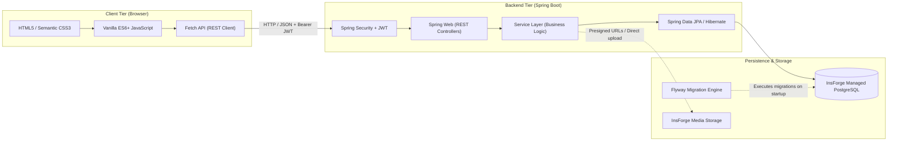
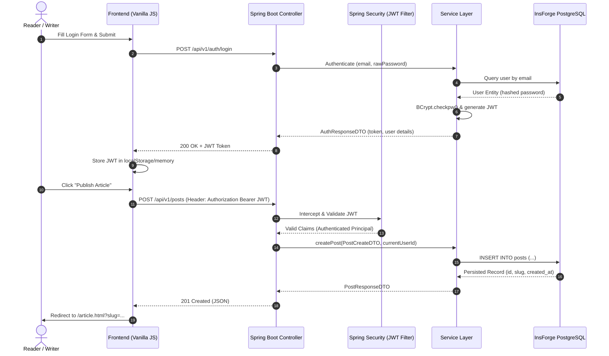

# WriteSpace

> A modern, distraction-free social publishing and long-form blogging platform designed for thoughtful writers and engaged readers.

[](https://spring.io/projects/spring-boot)
[](https://www.oracle.com/java/)
[](https://www.postgresql.org/)
[](LICENSE)
[](#)

---

## 1. Project Title and Introduction

**WriteSpace** is an open-source, full-stack social publishing platform built to bridge the gap between long-form editorial publishing and social network interactivity. 

While conventional social networks (such as X, Instagram, and Threads) emphasize fleeting micro-updates, viral algorithmic amplification, and multimedia feeds, WriteSpace is architected for **ideas, essays, deep technical guides, and community discourse**. Inspired by the editorial elegance of Substack, the discoverability of Medium, and the social networking primitives of modern microblogging platforms, WriteSpace provides an uncompromised environment where authors publish rich articles and readers follow creators, curate personal reading lists, exchange commentary, and discover meaningful writing.

---

## 2. Project Overview

WriteSpace operates as a decoupled web application composed of:
- **Client Tier**: A responsive, lightweight Single-Page/Multi-Page hybrid client engineered with standard semantic HTML5, modern CSS3 (Custom Properties, Flexbox, CSS Grid), and modular vanilla JavaScript leveraging the native `fetch` API.
- **Backend Application Tier**: A robust, layered REST API powered by **Java 17+ and Spring Boot 3.x**, encapsulating domain business logic, data validation, transactions, and security policies.
- **Persistence Tier**: An enterprise-grade relational database powered by **PostgreSQL** (managed via **InsForge**), with schema lifecycle management governed by **Flyway** and object-relational mapping handled via **Spring Data JPA / Hibernate**.
- **Security & Identity Tier**: Stateless token-based security orchestrated by **Spring Security** and **JSON Web Tokens (JWT)**, with cryptographic password hashing implemented via **BCrypt**.

---

## 3. Problem Statement

Modern online content consumption suffers from severe systemic fragmentation:
1. **Shallow Engagement on Social Feeds**: Traditional social media platforms incentivize short attention spans, clickbait, and endless algorithmic scrolling, crowding out nuanced long-form journalism, research, and technical writing.
2. **Monetization and Paywall Fatigue on Publishing Platforms**: Traditional blogging platforms often impose aggressive paywalls, restrictive newsletter silos, and convoluted publishing mechanics that hinder emerging writers from building an organic readership.
3. **Overengineered Application Stacks**: Many contemporary applications accumulate excessive front-end framework bloat (heavy client bundles, hydration overhead, dependency vulnerabilities) and poorly structured backends with direct database exposure or duplicated business logic.
4. **Disconnection Between Writers and Audience**: Standard blogs lack native social graph features (following, user-to-user feeds, instant comment threads), forcing creators to maintain distinct tools for writing, hosting, and social audience acquisition.

---

## 4. Proposed Solution

WriteSpace provides a unified, lightweight, high-performance publishing platform tailored to written content:
- **Clean Editorial Experience**: A minimalist writing and reading interface focused entirely on typography, readability, and content structure.
- **Integrated Social Graph**: Native following mechanisms, chronological subscriber feeds, author profiles, like aggregations, and nested discussion threads.
- **Strict Decoupled Architecture**: A hardened Spring Boot backend maintaining single-source-of-truth business rules, exposing a documented REST API, and completely shielding database credentials from client code.
- **Reliable Managed Relational Persistence**: ACID-compliant PostgreSQL managed through InsForge, backed by deterministic Flyway schema migrations and relational integrity constraints (e.g., unique likes, non-self-following checks).

---

## 5. Project Objectives

1. **Architectural Separation**: Enforce a strict decoupling where the front-end presentation layer communicates exclusively through authenticated, sanitized REST endpoints.
2. **Data Integrity & Robustness**: Guarantee consistent relational invariants at the database level using PostgreSQL foreign keys, composite unique constraints, check constraints, and indexed join queries.
3. **Stateless Scalability**: Maintain a stateless authentication model using signed JWT tokens, facilitating horizontal scalability without distributed session storage dependencies.
4. **Performance & Simplicity**: Achieve sub-second page loads without heavy client-side JavaScript frameworks, utilizing native web standards, optimized queries, and standard pagination.
5. **Implementation-Ready Blueprint**: Provide enterprise-grade technical documentation, clear schemas, explicit API contracts, and an organized project directory structure for immediate team execution.

---

## 6. Main Features

### Writer & Publishing Suite
- **Rich Article Editor**: Write, preview, and format articles with titles, subtitles, tags/categories, cover images, and body content.
- **Draft & Publication Management**: Save unfinished works as private drafts; publish publicly with an instantaneous timestamp and read-time calculation.
- **Article Lifecycle Control**: Update published articles or delete content with cascade cleanups (comments, likes, bookmarks).

### Social Discovery & Community
- **Personalized Following Feed**: Dedicated stream displaying chronologically ordered articles from followed authors.
- **Global Discovery & Explore**: Browse articles filtered by topic tags or search keywords.
- **Social Graph Interactions**: One-click follow/unfollow capability with dynamic follower/following counter recalculations.
- **Discussion & Engagement**: Article-level like/unlike toggling and threaded comment sections for reader discourse.
- **Personal Library & Bookmarks**: Save articles to a personal bookmark list for later reading.

### Identity & Profiles
- **Author Profile Page**: Public author landing page showcasing biography, avatar, statistics, follower metrics, and published catalog.
- **Self-Service Profile Management**: Update avatar, bio, display name, and account security parameters.

---

## 7. User Roles

WriteSpace enforces a clean, extensible Role-Based Access Control (RBAC) model managed by Spring Security:

| Role | Scope & Permissions | Access Level |
|---|---|---|
| **Anonymous / Guest** | Browse public articles, view author profiles, search posts, read comments, access registration and login endpoints. | Read-Only (Public Endpoints) |
| **Authenticated User (ROLE_USER)** | All Guest capabilities plus: publish/edit/delete own articles, save drafts, follow/unfollow authors, like/unlike posts, post comments, manage bookmarks, update personal profile. | Read & Write (Protected Endpoints) |
| **Administrator (ROLE_ADMIN)** | All User capabilities plus: moderate abusive comments, flag/remove policy-violating posts, deactivate malicious accounts, view system health metrics. *(Phase 2 / Future expansion)* | Full Administrative Access |

---

## 8. Technology Stack



### Detailed Component Matrix

- **Frontend**:
  - Semantic HTML5 for accessible structural markup.
  - CSS3 with CSS Custom Properties (design tokens), Flexbox, CSS Grid, and media queries.
  - Modern ES6+ JavaScript (modules, async/await, native DOM APIs, Web Storage).
  - Native `Fetch API` with centralized response and token interception.
- **Backend Application Framework**:
  - **Language**: Java 17 LTS (or 21 LTS).
  - **Framework**: Spring Boot 3.2.x.
  - **Core Modules**: `spring-boot-starter-web`, `spring-boot-starter-security`, `spring-boot-starter-data-jpa`, `spring-boot-starter-validation`.
  - **Security**: Spring Security 6.x, `jjwt-api` (io.jsonwebtoken 0.12.x), BCrypt password hashing.
  - **Build Tool**: Apache Maven 3.8+.
- **Database & Persistence**:
  - **Database Engine**: PostgreSQL 15+ (Hosted and managed via **InsForge**).
  - **ORM**: Hibernate 6.x via Spring Data JPA.
  - **Connection Pooling**: HikariCP.
  - **Schema Migrations**: Flyway Core.
- **Media & Asset Storage**:
  - **InsForge Storage** (or standard S3-compatible object storage via secure backend proxy).

---

## 9. System Architecture Overview

WriteSpace adheres to a **Strict Layered Architecture** with distinct separation of concerns:

1. **Presentation Layer (Frontend)**: Static files served from a CDN or web server (e.g., Nginx, Netlify, or Vercel). The frontend maintains zero direct connection to database infrastructure.
2. **Boundary Layer (Controllers & Filters)**: Spring Security intercepts all requests, validates incoming JWT bearer tokens, establishes the security context, and routes valid HTTP requests to REST Controllers.
3. **Application Layer (Services)**: Encapsulates pure business rules, entity validations, transaction boundaries (`@Transactional`), and event dispatching.
4. **Data Access Layer (Repositories)**: Spring Data JPA interfaces executing type-safe queries, custom JPQL queries, and database pagination.
5. **Persistence Layer (PostgreSQL)**: Physical relational storage in InsForge PostgreSQL enforcing strict foreign keys, cascade rules, and uniqueness indexes.

---

## 10. Application Workflow



---

## 11. Database Overview

The relational model utilizes clean foreign key linkages and strict constraints to guarantee data integrity:

- `users`: Core identity records, unique email and username, encrypted password hashes, profile bio and avatar URLs.
- `posts`: Article title, URL slug (unique), markdown/plain text content, excerpt, read time, publication status (`DRAFT`, `PUBLISHED`), and author foreign key.
- `comments`: Nested reader responses linked to both `post_id` and `user_id`.
- `likes`: Composite unique key `(user_id, post_id)` ensuring an author can like an article exactly once.
- `follows`: Composite unique key `(follower_id, following_id)` with a database check constraint preventing self-following (`follower_id <> following_id`).
- `bookmarks`: Composite unique key `(user_id, post_id)` providing personal reading list management.

For full schema definitions, index designs, and SQL scripts, consult [docs/DATABASE_SCHEMA.md](file:///c:/Users/mokum/Downloads/Social%20Media%20Platform/docs/DATABASE_SCHEMA.md).

---

## 12. Backend Architecture

The backend code structure enforces separation between interface adapters, business services, and database persistence:

```
com.writespace/
├── config/             # Spring Security, CORS, WebMvc, Flyway configurations
├── controller/         # REST Controllers handling HTTP requests & response codes
├── dto/                # Data Transfer Objects (Request/Response schemas)
├── entity/             # JPA Entities mapped to PostgreSQL tables
├── exception/          # Custom exceptions & global @RestControllerAdvice handler
├── repository/         # Spring Data JPA interfaces with derived/JPQL queries
├── security/           # JWT token provider, authentication filter, UserDetailsService
└── service/            # Core business logic interfaces and implementations
```

Every incoming request passes through:
`Controller` $\rightarrow$ `Service` $\rightarrow$ `Repository` $\rightarrow$ `Database`
Every outgoing response returns as an immutable DTO:
`Database` $\rightarrow$ `Repository` $\rightarrow$ `Service` $\rightarrow$ `DTO Mapper` $\rightarrow$ `Controller` $\rightarrow$ `Client`

---

## 13. Frontend Architecture

The user interface avoids bulky compilation pipelines, maintaining immediate browser execution, high developer velocity, and zero hydration lags:

- **Static Assets**:
  - `index.html`: Global landing page and discovery feed.
  - `feed.html`: Following feed for logged-in users.
  - `article.html`: Single article view with comments and like toggles.
  - `editor.html`: Markdown/text publishing canvas for authors.
  - `profile.html`: Public writer profiles and catalog.
  - `login.html` & `register.html`: Clean authentication interfaces.
  - `bookmarks.html`: Saved articles collection.
- **JavaScript Engine**:
  - `js/api.js`: Centralized HTTP fetch client attaching `Authorization: Bearer <token>` and normalizing error payloads.
  - `js/auth.js`: Session management, token decoding, and login/logout state triggers.
  - `js/ui.js`: DOM manipulation utilities, notification toasts, and formatting helpers.
  - Dedicated page controllers (e.g., `js/pages/article.js`, `js/pages/editor.js`).

---

## 14. API Overview

All backend endpoints are prefixed with `/api/v1` and use standard HTTP methods:

| Module | Method | Endpoint | Description | Auth Required |
|---|---|---|---|---|
| **Auth** | `POST` | `/api/v1/auth/register` | Register a new user account | No |
| **Auth** | `POST` | `/api/v1/auth/login` | Authenticate and obtain JWT | No |
| **Auth** | `GET` | `/api/v1/auth/me` | Fetch authenticated user context | Yes |
| **Users** | `GET` | `/api/v1/users/{username}` | Fetch public author profile | No |
| **Users** | `PUT` | `/api/v1/users/profile` | Update bio, avatar, display name | Yes |
| **Articles**| `GET` | `/api/v1/posts` | Paginated public articles | No |
| **Articles**| `GET` | `/api/v1/posts/{slug}` | Fetch single article by slug | No |
| **Articles**| `POST`| `/api/v1/posts` | Create new article or draft | Yes |
| **Articles**| `PUT` | `/api/v1/posts/{id}` | Update existing article | Yes (Owner) |
| **Articles**| `DELETE`| `/api/v1/posts/{id}` | Delete article | Yes (Owner) |
| **Feed** | `GET` | `/api/v1/feed` | Chronological feed of followed authors | Yes |
| **Social** | `POST` | `/api/v1/posts/{id}/like` | Toggle like status | Yes |
| **Social** | `POST` | `/api/v1/posts/{id}/comments` | Post comment on article | Yes |
| **Social** | `POST` | `/api/v1/users/{id}/follow` | Follow / unfollow writer | Yes |
| **Bookmarks**| `POST`| `/api/v1/posts/{id}/bookmark` | Save / remove bookmark | Yes |

For full request/response schemas, JSON payloads, and validation constraints, see [docs/API_DOCUMENTATION.md](file:///c:/Users/mokum/Downloads/Social%20Media%20Platform/docs/API_DOCUMENTATION.md).

---

## 15. Authentication and Authorization

WriteSpace implements **Stateless JWT Authentication**:

1. **Credentials Ingestion**: The client posts email and password to `/api/v1/auth/login`.
2. **Password Verification**: The `AuthService` retrieves the user entity and evaluates the candidate password against the stored BCrypt hash using `PasswordEncoder.matches()`.
3. **Token Issuance**: Upon verification, a cryptographically signed HMAC-SHA256 JWT is returned containing user claims (`sub: userId`, `email`, `role`, `exp`).
4. **Subsequent Request Validation**: The client includes the token in the `Authorization: Bearer <token>` header. The backend `JwtAuthenticationFilter` intercepts the request, validates the signature, extracts user details, and injects an authenticated `UsernamePasswordAuthenticationToken` into the `SecurityContextHolder`.
5. **Ownership Authorization**: Modification of articles or deletion of comments enforces resource ownership checks at the service layer to prevent Insecure Direct Object References (IDOR).

---

## 16. Folder Structure

```
WriteSpace/
├── README.md                           # Master project documentation
├── .env.example                        # Template for environment variables
├── .gitignore                          # Standard Git ignore rules
│
├── docs/                               # Complete project documentation suite
│   ├── DOCUMENTATION_INDEX.md          # Navigation map of all documentation
│   ├── PROJECT_OVERVIEW.md             # Vision, mission, goals, audience
│   ├── ARCHITECTURE.md                 # Deep technical architecture manual
│   ├── REQUIREMENTS.md                 # SRS, functional and non-functional reqs
│   ├── FEATURES.md                     # Comprehensive feature catalog & MVP matrix
│   ├── DATABASE_SCHEMA.md              # Relational schema, DDL, Flyway, indexes
│   ├── API_DOCUMENTATION.md            # REST API specification & payloads
│   ├── AUTHENTICATION_SECURITY.md      # Spring Security, JWT, hardening guide
│   ├── BACKEND_DOCUMENTATION.md        # Spring Boot engineering manual
│   ├── FRONTEND_DOCUMENTATION.md       # Vanilla JS & CSS UI architecture
│   ├── USER_WORKFLOWS.md               # User journeys and sequence flows
│   ├── UI_UX_GUIDELINES.md             # Design tokens, typography, component rules
│   ├── PROJECT_STRUCTURE.md            # Directory and file taxonomy
│   ├── DEVELOPMENT_ROADMAP.md          # Phased engineering roadmap
│   ├── TESTING_STRATEGY.md             # Quality assurance and testing manual
│   ├── DEPLOYMENT_GUIDE.md             # Local, cloud, and InsForge deployment
│   ├── CONTRIBUTING.md                 # Contribution workflows and Git standards
│   └── FUTURE_ENHANCEMENTS.md          # Long-term feature roadmap
│
├── backend/                            # Spring Boot Java application
│   ├── pom.xml                         # Maven dependencies and build plugins
│   ├── mvnw / mvnw.cmd                 # Maven wrapper scripts
│   └── src/
│       ├── main/
│       │   ├── java/com/writespace/    # Application source code
│       │   └── resources/
│       │       ├── application.yml     # Application configuration
│       │       └── db/migration/       # Flyway SQL migration scripts (V1, V2...)
│       └── test/java/com/writespace/   # Unit and integration test suites
│
└── frontend/                           # Responsive Web Client (HTML/CSS/JS)
    ├── index.html                      # Landing & Explore page
    ├── feed.html                       # Following Feed page
    ├── article.html                    # Article reading view
    ├── editor.html                     # Publishing canvas
    ├── profile.html                    # Author profile page
    ├── bookmarks.html                  # Saved reading list
    ├── login.html                      # Login page
    ├── register.html                   # Registration page
    ├── css/                            # Modular stylesheets
    │   ├── variables.css               # Design tokens & color system
    │   ├── base.css                    # Typography, resets, global layouts
    │   ├── components.css              # Cards, buttons, inputs, modals
    │   └── pages/                      # Page-specific styling rules
    └── js/                             # Modular JavaScript files
        ├── api.js                      # REST API client & fetch wrappers
        ├── auth.js                     # Authentication context & storage
        ├── ui.js                       # Reusable UI alerts, formatting, DOM helpers
        └── pages/                      # Page controllers
```

---

## 17. Database Setup

1. **Local PostgreSQL or Managed Cloud Database**: Ensure PostgreSQL 15+ is active.
2. **Database Provisioning**:
   ```sql
   CREATE DATABASE writespace_db;
   CREATE USER writespace_user WITH ENCRYPTED PASSWORD 'StrongSecretPassword123!';
   GRANT ALL PRIVILEGES ON DATABASE writespace_db TO writespace_user;
   ```
3. **Automated Flyway Migrations**: When Spring Boot launches, Flyway executes migration scripts found under `src/main/resources/db/migration/` (`V1__init_schema.sql`, `V2__seed_test_data.sql`), ensuring strict schema consistency across all developers.

---

## 18. InsForge Configuration

InsForge provides fully managed PostgreSQL instances with automated backups, connection pooling, and SSL encryption.

1. **Dashboard Setup**: Create a new project in the [InsForge Console](https://insforge.app).
2. **Database Connection Details**: Locate your connection string in the Project Settings:
   - **Host**: `db.insforge.app` (or assigned project host)
   - **Port**: `5432`
   - **Database**: `writespace_db`
   - **Username**: Provided database user
   - **SSL Mode**: `require`
3. **Storage Configuration (Optional)**: If using InsForge Storage for user avatars and article cover photos, obtain your storage bucket endpoint and API secret token.

---

## 19. Backend Installation

### Prerequisites
- **JDK 17+** (Eclipse Temurin, Amazon Corretto, or Oracle JDK).
- **Apache Maven 3.8+** (or use the included `./mvnw`).
- Valid PostgreSQL connection credentials.

### Installation Steps
```bash
# Navigate to backend directory
cd backend

# Compile and resolve dependencies
./mvnw clean compile

# Execute test suite
./mvnw test

# Package executable JAR
./mvnw clean package -DskipTests
```

---

## 20. Frontend Installation

Because the frontend is built entirely on native HTML5, CSS3, and modern JavaScript, **no build step, bundler, or heavy `node_modules` installation is required**.

### Running with a Lightweight Static Server
You can serve the frontend with any local HTTP server:

```bash
# Navigate to frontend folder
cd frontend

# Option A: Python 3 built-in HTTP server
python -m http.server 3000

# Option B: Node.js http-server
npx http-server -p 3000 -c-1

# Option C: VS Code Live Server extension
# Right click on index.html -> "Open with Live Server" (runs on port 5500)
```

---

## 21. Environment Variables

Create an active `.env` file in your runtime environment or supply environment variables directly to Spring Boot:

```ini
# Server
PORT=8080
SPRING_PROFILES_ACTIVE=dev

# InsForge PostgreSQL
SPRING_DATASOURCE_URL=jdbc:postgresql://db.insforge.app:5432/writespace_db?sslmode=require
SPRING_DATASOURCE_USERNAME=writespace_user
SPRING_DATASOURCE_PASSWORD=YourSecurePassword123!

# JWT Token Security (Base64 256-bit key)
JWT_SECRET=404E635266556A586E3272357538782F413F4428472B4B6250645367566B5970
JWT_EXPIRATION_MS=86400000

# CORS Allowed Origins
FRONTEND_URL=http://localhost:3000,http://127.0.0.1:5500
```

---

## 22. Running the Application Locally

1. **Launch PostgreSQL Database** (or confirm network access to your InsForge database).
2. **Start Spring Boot Backend**:
   ```bash
   cd backend
   ./mvnw spring-boot:run
   ```
   *The server will start on `http://localhost:8080` and Flyway will apply migrations automatically.*
3. **Serve Frontend**:
   ```bash
   cd frontend
   python -m http.server 3000
   ```
4. **Open Browser**:
   Navigate to `http://localhost:3000` to interact with WriteSpace.

---

## 23. API Testing

A complete Postman Collection is provided in the repository at `docs/WriteSpace_API_Collection.json`.

### Rapid Smoke Test via cURL

```bash
# 1. Register a new user
curl -X POST http://localhost:8080/api/v1/auth/register \
  -H "Content-Type: application/json" \
  -d '{"username":"arthur_conan","email":"arthur@example.com","password":"Password123!","displayName":"Arthur Conan"}'

# 2. Login to acquire JWT
curl -X POST http://localhost:8080/api/v1/auth/login \
  -H "Content-Type: application/json" \
  -d '{"email":"arthur@example.com","password":"Password123!"}'

# 3. Create an article using the received token
curl -X POST http://localhost:8080/api/v1/posts \
  -H "Content-Type: application/json" \
  -H "Authorization: Bearer <PASTE_YOUR_JWT_HERE>" \
  -d '{"title":"The Art of Observation","content":"It has long been an axiom of mine...","status":"PUBLISHED","tags":["writing","investigation"]}'
```

---

## 24. Deployment Architecture

WriteSpace separates static client delivery from server-side computational and transactional workloads:

- **Frontend Hosting**: Delivered via high-speed global Edge CDN (e.g., Netlify, Vercel, AWS S3 + CloudFront, or Cloudflare Pages).
- **Backend Application Hosting**: Containerized via Docker or deployed on a Java 17 runtime container (e.g., Railway, Render, AWS ECS, or DigitalOcean App Platform).
- **Database**: InsForge Managed PostgreSQL with TLS 1.3 enforced, connection pooling, and multi-zone durability.
- **Media Assets**: Uploaded directly or through presigned proxy endpoints into InsForge Storage or AWS S3.

---

## 25. Security Considerations

- **No Plaintext Passwords**: Passwords hashed using standard BCrypt with an adaptive work factor (12 rounds).
- **JWT Signature Defense**: Cryptographically signed HMAC-SHA256 tokens with short expiration lifetimes and secret keys stored exclusively in server environment variables.
- **SQL Injection Prevention**: Parameterized queries via Spring Data JPA and Hibernate ORM eliminate SQL injection vectors.
- **Cross-Site Scripting (XSS)**: Strict DOM manipulation rules (using `textContent` over `innerHTML` where feasible) and server-side HTML content sanitization on published articles.
- **CORS Configuration**: Restrictive Cross-Origin Resource Sharing policy strictly authorizing configured frontend origins.
- **Authorization Guard**: Method-level and service-layer verification guarantees that authors can only alter or remove their own posts, comments, and profile configurations.

---

## 26. Testing Strategy

WriteSpace maintains a multi-tier testing strategy:
- **Unit Testing**: JUnit 5 and Mockito for isolated domain business logic, DTO mapping, and security filter verification.
- **Repository Testing**: `@DataJpaTest` with Testcontainers (or H2 in test profile) validating PostgreSQL constraints, derived queries, and custom JPQL.
- **Integration Testing**: `@SpringBootTest` with `MockMvc` testing full HTTP request/response pipelines, authentication barriers, and error status code mappings.
- **Frontend Contract Testing**: Verification of client API client methods against mock JSON fixtures and edge cases (expired tokens, network failure).

---

## 27. Future Enhancements

- **Direct Email Newsletter Dispatch**: Automated email generation delivered to subscribers whenever an author publishes a new issue.
- **Monetization & Paid Subscriptions**: Stripe integration enabling readers to pledge recurring monthly/annual subscriptions to writers.
- **Rich Collaborative Editor**: WYSIWYG block editor (TipTap / ProseMirror) with drag-and-drop media embeds.
- **Real-Time Notification Pipeline**: WebSocket (STOMP) or Server-Sent Events (SSE) broadcasting instant alerts on likes, new comments, and follows.
- **Reading Time & Analytics Dashboard**: Detailed metrics showing reader impressions, read completion rates, and referrer traffic.

---

## 28. Development Roadmap

- [x] **Phase 0**: Architecture, documentation, schema modeling, and API contract design.
- [ ] **Phase 1**: Spring Boot project scaffolding, Flyway migrations, and InsForge database connectivity.
- [ ] **Phase 2**: Authentication subsystem (BCrypt, Spring Security filter chain, JWT provider).
- [ ] **Phase 3**: User profile services, DTOs, and profile endpoints.
- [ ] **Phase 4**: Article publishing core (CRUD, slug generation, draft state).
- [ ] **Phase 5**: Social interaction engine (likes, comments, bookmarks).
- [ ] **Phase 6**: Social graph & following feed algorithms.
- [ ] **Phase 7**: Frontend implementation (HTML5, responsive CSS3, vanilla JS API integration).
- [ ] **Phase 8**: Comprehensive testing suite, containerization, and production cloud deployment.

---

## 29. Project Scope and Limitations

### In-Scope
- Complete single-author publishing lifecycle (draft, preview, publish, edit, delete).
- Interactive reader engagement (liking, nested commenting, following writers, bookmarking).
- Personalized chronologically sorted following feed and global explore feed.
- High-performance, accessible, responsive user interface without framework overhead.
- Production-grade security, data validation, and error reporting.

### Out-of-Scope (for Initial MVP)
- Real-time video/audio streaming.
- Mobile native application packaging (iOS/Android); mobile access is handled via mobile-responsive web.
- Multi-author collaborative real-time Google Docs-style editing.
- Complex full-text search clusters (e.g., Elasticsearch); search is executed via PostgreSQL text search indexes.

---

## 30. Contribution Guidelines

We welcome community contributions, architectural refinements, and bug fixes:
1. Review [docs/CONTRIBUTING.md](file:///c:/Users/mokum/Downloads/Social%20Media%20Platform/docs/CONTRIBUTING.md) for code quality requirements, Git branch conventions, and testing criteria.
2. Fork the repository and create a feature branch (`git checkout -b feature/issue-description`).
3. Ensure all Maven unit tests pass (`./mvnw test`) and documentation is updated accordingly.
4. Submit a descriptive Pull Request referencing the resolved issue.

---

## 31. License

This project is licensed under the **MIT License**. See the `LICENSE` file for details.

```
Copyright (c) 2026 WriteSpace Contributors

Permission is hereby granted, free of charge, to any person obtaining a copy
of this software and associated documentation files (the "Software"), to deal
in the Software without restriction, including without limitation the rights
to use, copy, modify, merge, publish, distribute, sublicense, and/or sell
copies of the Software, and to permit persons to whom the Software is
furnished to do so, subject to the following conditions:

The above copyright notice and this permission notice shall be included in all
copies or substantial portions of the Software.
```
