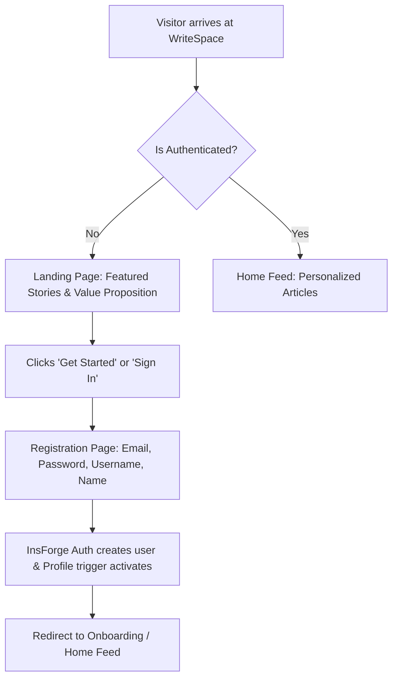
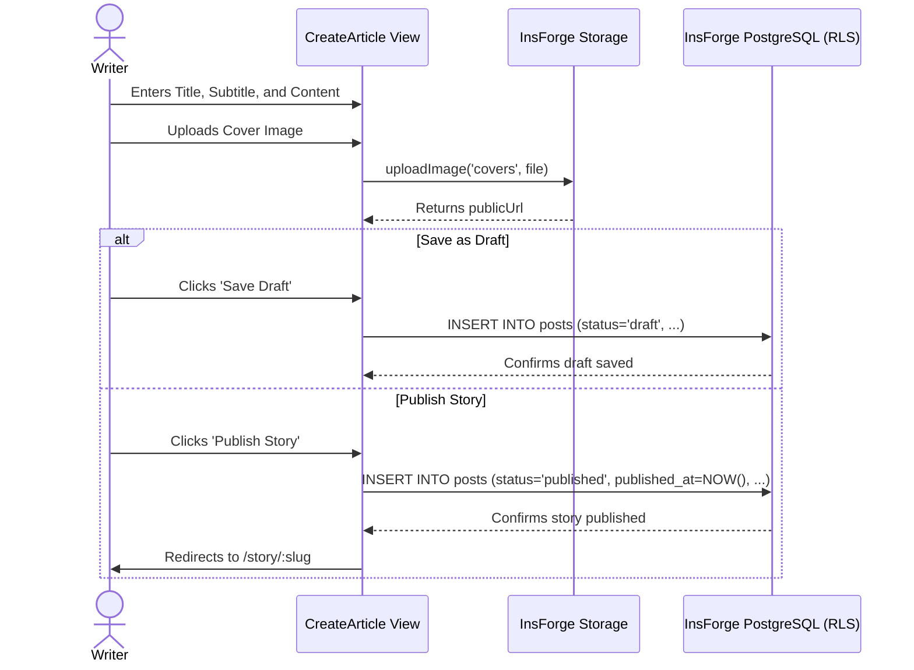
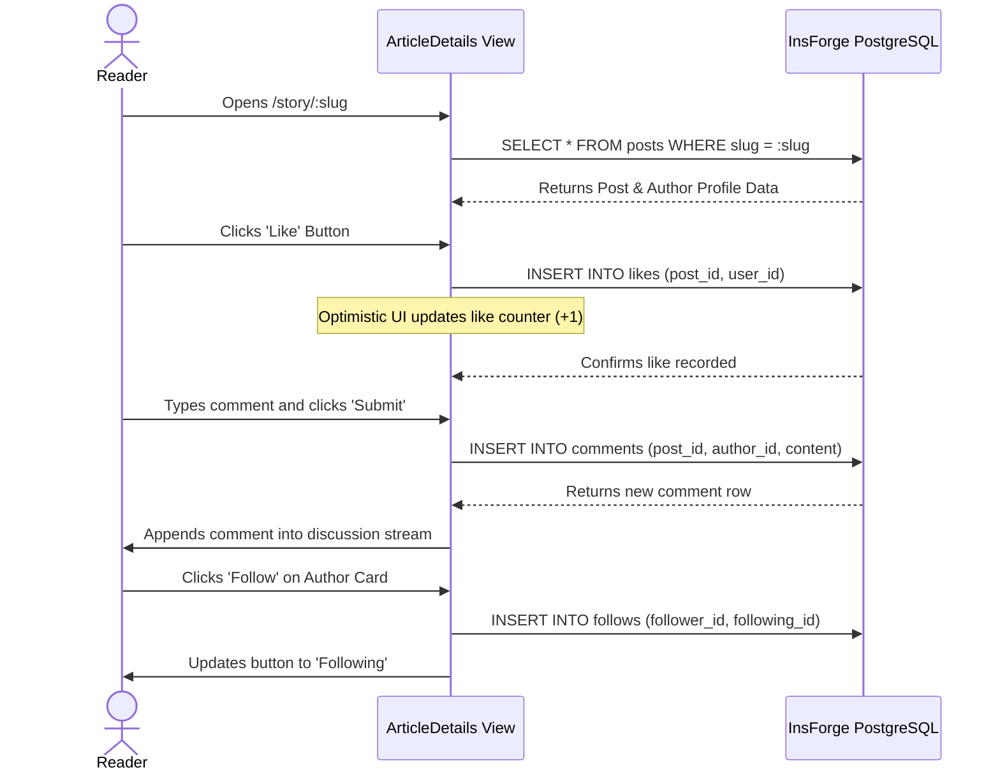
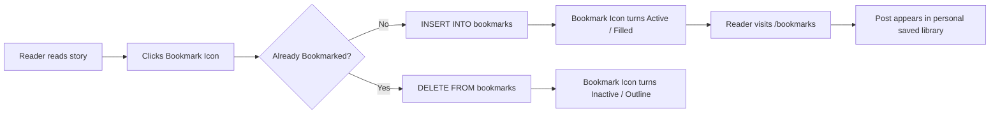

# WriteSpace User Workflows & Journey Maps 🗺️

This document describes the primary user flows, state transitions, and step-by-step journeys for visitors, readers, and authors in WriteSpace.

---

## 1. Visitor / Reader Onboarding Journey

### Steps:
1. Visitor browses public articles on Landing or Explore feed.
2. Visitor clicks "Sign in" or "Get Started".
3. Form validates:
   - Email format
   - Password length (>= 8 characters)
   - Unique `@username` availability
4. Auth API executes `signUp()`.
5. User is redirected to `/` with immediate session authentication.

---

## 2. Story Authoring & Publishing Workflow

### Steps:
1. Author clicks "Write" icon in navigation bar.
2. If unauthenticated, redirected to `/login` with return intent.
3. Author enters:
   - Compelling title
   - Subtitle / summary
   - Markdown or formatted content
   - Selected topic category
   - Optional cover photo (uploaded asynchronously to InsForge Storage)
4. Reading time is dynamically calculated: `ceil(wordCount / 200)`.
5. Author clicks "Publish".
6. Post becomes immediately discoverable in public feeds.

---

## 3. Reader Engagement & Social Interaction Workflow

---

## 4. Bookmarking & Private Library Workflow

---

## 5. Writer Dashboard Management Workflow

1. Author navigates to `/dashboard`.
2. Dashboard queries `posts` where `author_id = auth.uid()`.
3. Author toggles between **Published Stories** and **Drafts**.
4. Actions available per story:
   - **Edit**: Opens `/edit/:id` populated with existing data.
   - **View**: Opens `/story/:slug` in reader mode.
   - **Delete**: Prompts confirmation modal; executes `DELETE FROM posts WHERE id = :id`.
   - **Unpublish**: Updates status back to `draft`.
