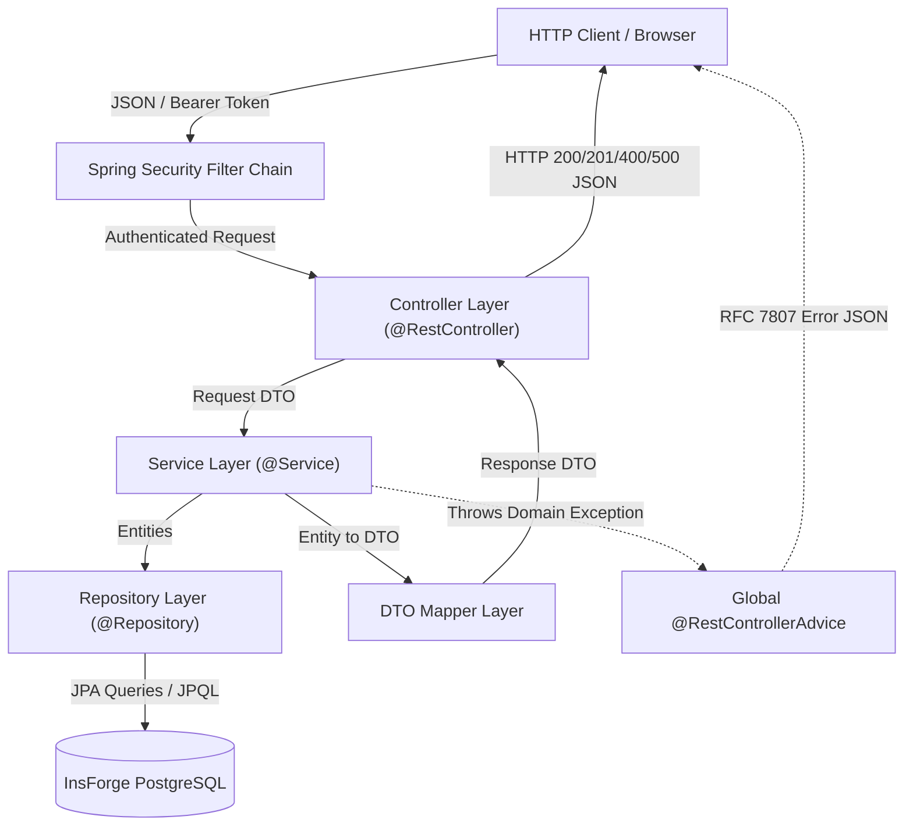
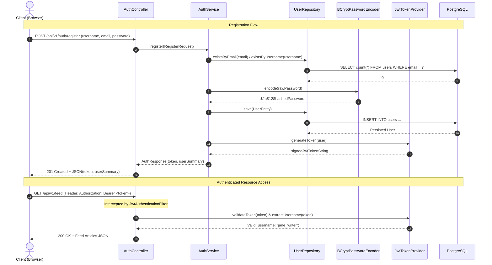
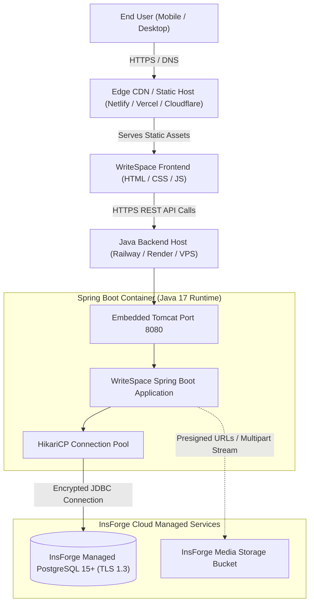
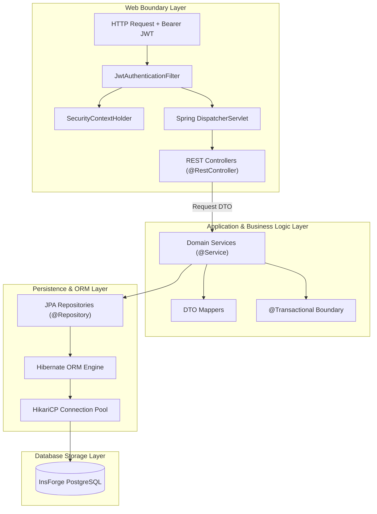
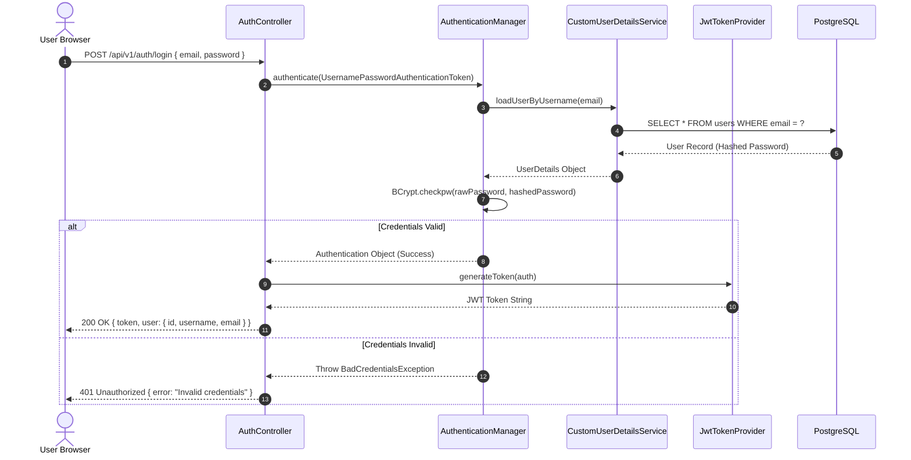
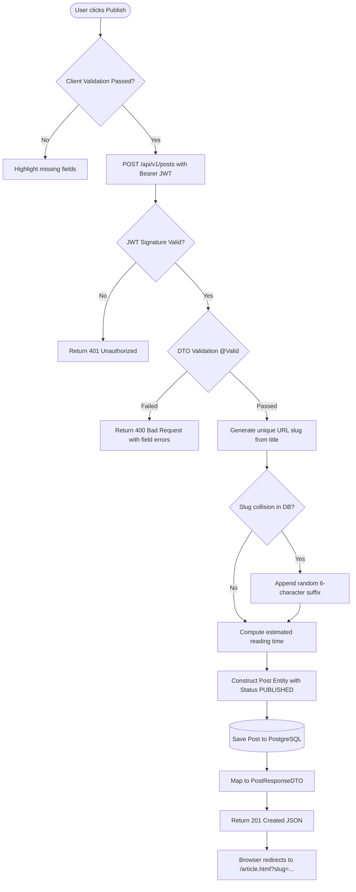
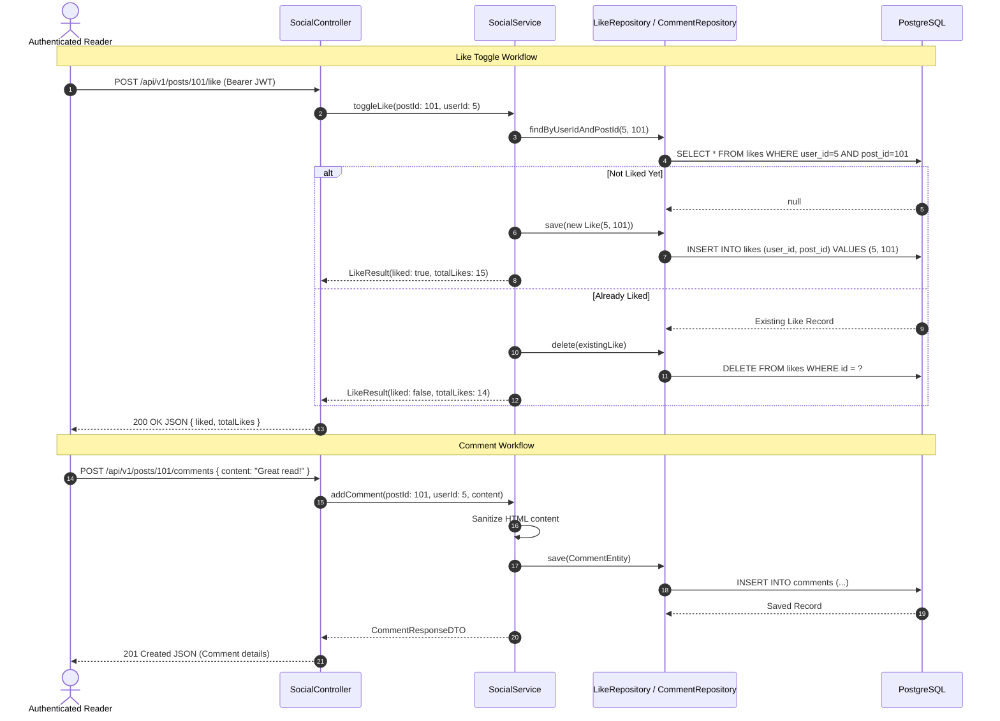
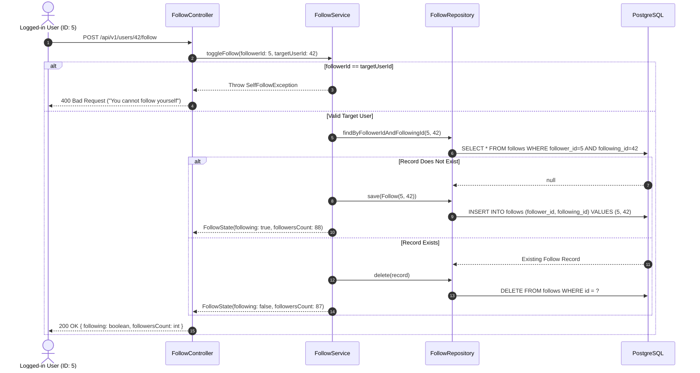
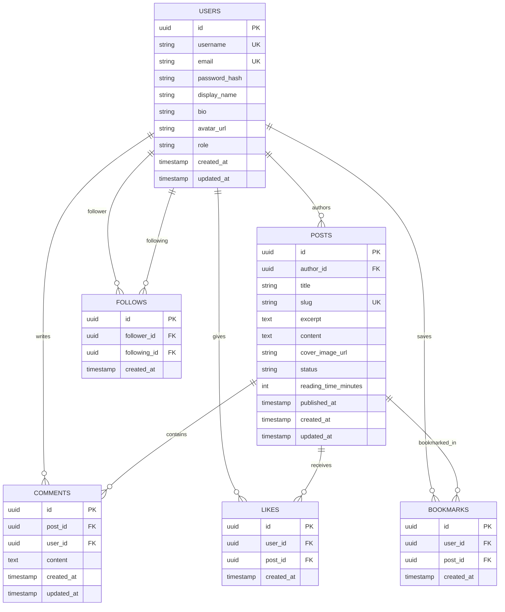

# WriteSpace Technical Architecture Manual

> **Document Version:** 1.0.0  
> **Target Audience:** Systems Architects, Backend Engineers, Frontend Developers, DevOps Engineers  
> **Status:** Implementation-Ready Architecture Specification

---

## Table of Contents
1. [Architecture Introduction](#1-architecture-introduction)
   - 1.1 Architecture Goals
   - 1.2 Architectural Principles
   - 1.3 Selected Architectural Style
   - 1.4 Rationale for Layered Architecture
2. [High-Level System Architecture](#2-high-level-system-architecture)
   - 2.1 Component Flow Overview
   - 2.2 Storage & Persistence Topology
3. [Frontend Architecture](#3-frontend-architecture)
   - 3.1 Presentation & DOM Architecture
   - 3.2 Modular JavaScript API Client
   - 3.3 Client-Side Authentication Handling
   - 3.4 State Management Strategy
   - 3.5 Page Routing & Navigation
   - 3.6 Error Handling & User Feedback
   - 3.7 Responsive & Accessible Design Philosophy
4. [Backend Layered Architecture](#4-backend-layered-architecture)
   - 4.1 Controller Layer
   - 4.2 Service Layer
   - 4.3 Repository Layer
   - 4.4 Entity Layer
   - 4.5 Data Transfer Object (DTO) Layer
   - 4.6 Mapper Layer
   - 4.7 Security & Authorization Layer
   - 4.8 Configuration Layer
   - 4.9 Global Exception Handling Layer
   - 4.10 Layer Interaction & Boundary Rules
5. [Authentication & Authorization Architecture](#5-authentication--authorization-architecture)
   - 5.1 Registration Pipeline
   - 5.2 Login & Credential Verification
   - 5.3 BCrypt Cryptographic Hashing
   - 5.4 JWT Token Generation & Structure
   - 5.5 JWT Validation & Spring Security Filter Chain
   - 5.6 Authorization & Role-Based Access Control
   - 5.7 Token Expiration & Renewal Policies
   - 5.8 Stateless Logout Strategy
6. [Database Architecture & Persistence](#6-database-architecture--persistence)
   - 6.1 PostgreSQL Engine Overview
   - 6.2 InsForge Managed Connectivity & HikariCP
   - 6.3 Spring Data JPA & Hibernate ORM Configuration
   - 6.4 Relational Entity Mapping & Associations
   - 6.5 Flyway Database Schema Evolution
   - 6.6 Transaction Boundaries & Isolation
   - 6.7 Relational Integrity, Constraints & Index Strategy
7. [Complete Request Lifecycle Analysis](#7-complete-request-lifecycle-analysis)
   - 7.1 User Registration Lifecycle
   - 7.2 User Authentication (Login) Lifecycle
   - 7.3 Article Creation & Publication Lifecycle
   - 7.4 Article Liking Lifecycle
   - 7.5 Article Commenting Lifecycle
   - 7.6 Author Following Lifecycle
   - 7.7 Following Feed Retrieval Lifecycle
8. [Deployment & Infrastructure Architecture](#8-deployment--infrastructure-architecture)
   - 8.1 Static Frontend Hosting
   - 8.2 Spring Boot Runtime Environment
   - 8.3 Managed InsForge PostgreSQL Infrastructure
   - 8.4 Asset & Media Storage
   - 8.5 Environment Variable Orchestration
   - 8.6 Cross-Origin Resource Sharing (CORS) Configuration
   - 8.7 HTTPS & Transport Layer Security (TLS)
   - 8.8 Production Tuning Parameters
9. [Architecture Diagrams](#9-architecture-diagrams)
   - 9.1 High-Level Architecture Diagram
   - 9.2 Layered Backend Architecture Diagram
   - 9.3 Authentication Sequence Flow
   - 9.4 Article Publishing Lifecycle Flow
   - 9.5 Like and Comment Sequence Flow
   - 9.6 Follow / Unfollow Sequence Flow
   - 9.7 Database Entity-Relationship Diagram (ERD)
   - 9.8 Production Cloud Deployment Diagram
10. [Architectural Decision Records (ADRs)](#10-architectural-decision-records-adrs)
    - 10.1 Spring Boot vs. Node.js/Express or Django
    - 10.2 PostgreSQL vs. Document Databases (MongoDB)
    - 10.3 REST APIs vs. GraphQL or Server-Side Rendering
    - 10.4 Spring Data JPA vs. Raw JDBC / MyBatis
    - 10.5 Monolithic Layered Architecture vs. Microservices
    - 10.6 Stateless JWT vs. Server-Side Stateful Sessions
    - 10.7 InsForge-Managed PostgreSQL Selection
11. [Scalability, Performance & Future Evolution](#11-scalability-performance--future-evolution)
    - 11.1 Caching Strategies (Redis Integration)
    - 11.2 Database Read Replicas & Connection Pooling Tuning
    - 11.3 Asynchronous Processing & Background Tasks
    - 11.4 Full-Text Search Integration
    - 11.5 Notification Microservice Migration Path

---

## 1. Architecture Introduction

### 1.1 Architecture Goals
The WriteSpace architecture is engineered to fulfill five primary objectives:
1. **Editorial Quality & Reading Performance:** Serve long-form content with sub-200ms API response times and instant client rendering.
2. **Strict Data Integrity:** Guarantee deterministic relationships (authorship, unicity of likes, non-self-following, cascade deletions) through relational database invariants.
3. **Stateless Scalability:** Enable seamless horizontal scaling of application instances without session replication bottlenecks.
4. **Security by Design:** Prevent top application security vulnerabilities (SQL injection, XSS, CSRF, IDOR, sensitive credential leakage) through layered defensive mechanisms.
5. **Maintainability & Comprehensibility:** Establish explicit boundaries between interface adapters, business rules, and persistence entities to allow rapid onboarding and painless feature iteration.

### 1.2 Architectural Principles
- **Single Source of Truth:** Business logic, authorization rules, and data validations reside exclusively within the Spring Boot application tier. The client is treated as an untrusted presentation layer.
- **Fail-Fast Validation:** Inbound payloads are validated at the perimeter (HTTP Controller layer) before propagating to service methods.
- **Information Hiding:** JPA entities are never exposed across API boundaries. Strongly typed Data Transfer Objects (DTOs) enforce strict API contracts.
- **Immutability Where Appropriate:** DTOs and configuration values favor final, immutable data structures to mitigate concurrent mutation bugs.
- **Graceful Degradation & Zero-Build Front-End:** The front-end leverages native browser capabilities (ES6 modules, standard DOM APIs, CSS Custom Properties) to avoid brittle dependency chains.

### 1.3 Selected Architectural Style
WriteSpace implements a **Decoupled Client-Server Layered Architecture**. The frontend acts as a pure Single-Page/Multi-Page Application hybrid executing in the client's browser, communicating with the backend over JSON-based HTTP REST endpoints. The backend follows the classical **Clean Layered Architecture** (Controller, Service, Repository, Entity).

### 1.4 Rationale for Layered Architecture
While microservice and event-driven architectures offer benefits for large teams with disparate deployment cycles, they introduce immense operational complexity: distributed transactions, network latency overhead, distributed tracing requirements, and eventual consistency dilemmas. For WriteSpace, a structured, cohesive layered architecture maximizes developer productivity, enforces transactional consistency (ACID) via PostgreSQL, minimizes infrastructure costs, and simplifies testing.

---

## 2. High-Level System Architecture

### 2.1 Component Flow Overview
The application topology operates across three distinct tiers:
1. **Client Tier (Web Browser):** Executes HTML5, CSS3, and Vanilla JavaScript. Issues authenticated HTTP requests via the browser `Fetch API`.
2. **Backend Application Tier (Spring Boot):** An embedded Tomcat server running a Java 17+ Spring Boot service. Handles routing, security filtering, business validations, transactions, and JSON serialization.
3. **Persistence & Data Tier (InsForge PostgreSQL & Storage):** A managed PostgreSQL instance hosting relational tables, and an optional object storage repository for binary assets.

```
+-------------------------------------------------------------------------+
|                               Browser Client                            |
|  [ Semantic HTML5 ]  <-->  [ CSS3 Design System ]  <-->  [ Vanilla JS ] |
+-------------------------------------------------------------------------+
                                    |
                    HTTPS / JSON (REST API Calls)
                                    |
                                    v
+-------------------------------------------------------------------------+
|                    Spring Boot Application Backend                      |
|                                                                         |
|  [ Security Filter Chain: JwtAuthenticationFilter, CORS, RateLimiter ]  |
|                                   |                                     |
|                        [ REST Controller Layer ]                        |
|                                   |                                     |
|                         [ DTO Mapping Layer ]                           |
|                                   |                                     |
|                    [ Transactional Service Layer ]                      |
|                                   |                                     |
|                 [ Spring Data JPA Repository Layer ]                    |
|                                   |                                     |
|                     [ Hibernate ORM Engine ]                            |
+-------------------------------------------------------------------------+
                    |                                 |
           JDBC via HikariCP               HTTPS / REST Multipart
                    |                                 |
                    v                                 v
+--------------------------------------+   +------------------------------+
|     InsForge Managed PostgreSQL      |   |   InsForge Object Storage    |
| (ACID Relational Storage & Indexes)  |   | (User Avatars & Cover Photos)|
+--------------------------------------+   +------------------------------+
```

### 2.2 Storage & Persistence Topology
- **Managed Database:** PostgreSQL is provisioned and managed on InsForge, offering TLS 1.3 connectivity, automatic connection termination on idle timeouts, and automatic storage scaling.
- **Storage Subsystem:** Media assets (profile pictures, article banners) are uploaded either via a backend proxy endpoint that streams bytes to InsForge Storage, or through presigned upload URLs generated by the backend.

---

## 3. Frontend Architecture

### 3.1 Presentation & DOM Architecture
The frontend employs a modular structure without heavy JavaScript frameworks (such as React or Angular). Each page is represented by a clean semantic HTML5 document:
- `index.html`: Global public discovery, landing page, and category filters.
- `feed.html`: Authenticated follower feed.
- `article.html`: Deep reading interface with typography optimized for legibility.
- `editor.html`: Writing canvas with live preview and draft status indicators.
- `profile.html`: Public writer portfolio and follower statistics.
- `bookmarks.html`: Saved reading list.
- `login.html` & `register.html`: Clean credential forms.

### 3.2 Modular JavaScript API Client
All outbound communication is unified inside `frontend/js/api.js`. This module encapsulates:
- Base URL resolution based on current hostname or configured environment.
- Injection of the `Authorization: Bearer <token>` header if a valid session exists.
- Automatic transformation of JavaScript object payloads to JSON.
- Response normalization: handles HTTP 200/201 success payloads, unpacks pagination metadata, and parses RFC 7807 problem details upon error.
- Centralized detection of `401 Unauthorized` responses, triggering automatic local session invalidation and redirection to login.

```javascript
// Conceptual snippet of centralized fetch wrapper in api.js
export async function apiRequest(endpoint, options = {}) {
  const token = localStorage.getItem('writespace_jwt');
  const headers = {
    'Content-Type': 'application/json',
    ...(token ? { 'Authorization': `Bearer ${token}` } : {}),
    ...options.headers,
  };

  const response = await fetch(`${API_BASE_URL}${endpoint}`, {
    ...options,
    headers,
  });

  if (response.status === 401) {
    localStorage.removeItem('writespace_jwt');
    localStorage.removeItem('writespace_user');
    window.location.href = '/login.html?expired=true';
    throw new Error('Session expired');
  }

  if (!response.ok) {
    const errorData = await response.json().catch(() => ({}));
    throw new Error(errorData.message || `HTTP Error ${response.status}`);
  }

  return response.status === 204 ? null : await response.json();
}
```

### 3.3 Client-Side Authentication Handling
- **Storage Mechanism:** Upon successful login or registration, the JWT token and basic user identity (username, display name, avatar URL) are persisted in `localStorage`.
- **Token Claims Parsing:** The frontend decodes the base64 payload of the JWT client-side strictly to inspect expiration (`exp`) and username (`sub`), avoiding unnecessary network round-trips for superficial UI toggles.
- **State Guarding:** Protected pages (`editor.html`, `feed.html`, `bookmarks.html`) run an immediate authentication verification before DOM rendering: if no token exists, the user is redirected to `login.html`.

### 3.4 State Management Strategy
State is managed locally and reactively per page:
- **Global Auth State:** Read from `localStorage` on boot; updates notify the global navigation bar to toggle "Sign In" vs. "User Profile / Logout" buttons.
- **Page-Level State:** Stored in lightweight JavaScript closure objects (e.g., active article filters, current pagination page index, draft autosave timer IDs).
- **DOM Reconciliation:** Content updates are rendered by cloning HTML `<template>` elements or constructing DOM fragments using `document.createElement()`, ensuring text nodes are bound via `.textContent` to mitigate XSS risks.

### 3.5 Page Routing & Navigation
- Multi-page navigation utilizes standard browser URLs with query parameters (e.g., `/article.html?slug=mastering-spring-boot`, `/profile.html?u=jane_dev`).
- This design maximizes native browser history navigation, back-forward cache compatibility, and straightforward deep linking without complex client routers.

### 3.6 Error Handling & User Feedback
- **Toast Notification Engine:** A lightweight notification module (`ui.js`) renders non-blocking toast notifications (success, warning, error) in the upper-right viewport.
- **Inline Field Errors:** Forms highlight invalid input fields with descriptive validation messages returned by Spring Boot's `@Valid` error responses.
- **Skeleton Loaders:** Content containers display pulsing CSS placeholder blocks while asynchronous API calls resolve, eliminating layout shifts.

### 3.7 Responsive & Accessible Design Philosophy
- **Fluid Layouts:** Implemented with CSS Grid and Flexbox; no fixed pixel layouts. Breakpoints align with mobile (`< 640px`), tablet (`641px - 1024px`), and desktop (`> 1024px`).
- **Typography Scale:** High-contrast serif body fonts for reading articles (e.g., Charter, Merriweather, Georgia) and clean sans-serif fonts for navigational UI (Inter, system-ui).
- **Accessibility:** Semantic landmark tags (`<header>`, `<nav>`, `<main>`, `<article>`, `<aside>`, `<footer>`), keyboard tab indexes, ARIA attributes for dynamic dropdowns, and WCAG AA contrast compliance.

---

## 4. Backend Layered Architecture

The backend adheres strictly to the classic multi-layer pattern with clear separation of responsibilities:



### 4.1 Controller Layer
- **Annotations:** `@RestController`, `@RequestMapping("/api/v1/...")`.
- **Responsibilities:**
  - Map incoming HTTP requests to corresponding controller handler methods.
  - Parse path variables (`@PathVariable`), query parameters (`@RequestParam`), and JSON bodies (`@RequestBody`).
  - Trigger Java Bean Validation annotations (`@Valid`, `@NotNull`, `@Size`, `@Email`).
  - Return appropriate HTTP status codes (`200 OK`, `201 Created`, `204 No Content`, `404 Not Found`).
  - Delegate execution immediately to the Service layer; controllers **contain zero business logic**.

### 4.2 Service Layer
- **Annotations:** `@Service`, `@Transactional`.
- **Responsibilities:**
  - Execute domain business logic and enforce application rules.
  - Manage database transaction boundaries: atomic rollbacks upon uncaught runtime exceptions.
  - Verify authorization policies (e.g., ensuring an updating user is the actual author of an article).
  - Orchestrate interactions across multiple repositories.
  - Transform entities into output DTOs before returning data to controllers.

### 4.3 Repository Layer
- **Annotations:** `@Repository`.
- **Responsibilities:**
  - Implement Spring Data JPA `JpaRepository<T, ID>` interfaces.
  - Provide derived query methods (e.g., `findBySlugAndStatus(String slug, PostStatus status)`).
  - Execute optimized JPQL and native SQL queries using `@Query` with parameter binding to prevent SQL injection.
  - Handle database pagination and sorting through `Pageable` parameters.

### 4.4 Entity Layer
- **Annotations:** `@Entity`, `@Table`, `@Id`, `@GeneratedValue`, `@Column`, `@ManyToOne`, `@OneToMany`.
- **Responsibilities:**
  - Represent the relational schema as Java objects managed by the Hibernate Persistence Context.
  - Define primary keys, foreign key constraints, indexes, and column nullability.
  - Maintain audit timestamps via JPA auditing (`@CreatedDate`, `@LastModifiedDate`).

### 4.5 Data Transfer Object (DTO) Layer
- **Structure:** Java 17+ `record` classes or immutable POJOs.
- **Responsibilities:**
  - Act as decoupled contracts for incoming requests (`RegisterRequest`, `PostCreateRequest`, `CommentRequest`) and outgoing responses (`PostSummaryResponse`, `UserProfileResponse`).
  - Shield internal database structures (passwords, internal IDs, database metadata) from client exposure.
  - Enforce Bean Validation constraints at the perimeter.

### 4.6 Mapper Layer
- **Implementation:** Explicit mapper components (e.g., `PostMapper`, `UserMapper`) or MapStruct.
- **Responsibilities:**
  - Convert incoming request DTOs into JPA entities ready for persistence.
  - Convert JPA entities into outgoing response DTOs, including computed fields (such as calculated reading time, like counters, or follow states).

### 4.7 Security & Authorization Layer
- **Components:** `SecurityFilterChain`, `JwtAuthenticationFilter`, `JwtTokenProvider`, `CustomUserDetailsService`.
- **Responsibilities:**
  - Intercept every incoming request before it reaches the controller.
  - Verify and decode JWT tokens from the `Authorization` header.
  - Populate the `SecurityContextHolder` with authenticated principal details.
  - Enforce URL pattern restrictions (e.g., permit all GET on `/api/v1/posts/**`, require authentication for POST).

### 4.8 Configuration Layer
- **Components:** `SecurityConfig`, `WebMvcConfig` (CORS), `JpaConfig`, `OpenApiConfig`.
- **Responsibilities:**
  - Define Spring `@Bean` declarations for application wiring.
  - Configure CORS origins, headers, and credentials.
  - Set up password hashing encoders (`BCryptPasswordEncoder`).

### 4.9 Global Exception Handling Layer
- **Components:** `@RestControllerAdvice` implementing a centralized `GlobalExceptionHandler`.
- **Responsibilities:**
  - Catch standard exceptions (`MethodArgumentNotValidException`, `EntityNotFoundException`, `AccessDeniedException`, `BadCredentialsException`).
  - Catch domain exceptions (`DuplicateEmailException`, `InvalidSlugException`, `SelfFollowException`).
  - Format all errors into standard RFC 7807 / consistent JSON structures with clear error codes, timestamps, and field-level validation breakdowns.

### 4.10 Layer Interaction & Boundary Rules
1. **Unidirectional Dependency:** Dependencies flow strictly downward: Controller $\rightarrow$ Service $\rightarrow$ Repository. Repositories never reference Services; Services never reference Controllers.
2. **DTO Boundary:** Entities must never be returned directly by a Controller method. Entities stay confined to Repository and Service layers.
3. **Transaction Confinement:** Transactions (`@Transactional`) are initiated at the Service layer, never at the Controller layer.

---

## 5. Authentication & Authorization Architecture

WriteSpace adopts a **stateless, token-based authentication mechanism** using Spring Security and JSON Web Tokens (JWT).



### 5.1 Registration Pipeline
1. Client submits username, email, raw password, and optional display name.
2. `AuthController` validates constraints (`@NotBlank`, `@Email`, password regex).
3. `AuthService` verifies unicity of username and email against `UserRepository`. If duplicates exist, throws `ResourceAlreadyExistsException` (returns HTTP 409).
4. Password is encrypted using `BCryptPasswordEncoder`.
5. User entity is saved with role `ROLE_USER`.
6. JWT token is generated and returned with user profile metadata.

### 5.2 Login & Credential Verification
1. Client sends email/username and raw password.
2. Authentication manager verifies credentials against the database record using BCrypt's constant-time comparison algorithm.
3. If credentials match, a new JWT signed with HMAC-SHA256 is generated.
4. If credentials fail, a generic `BadCredentialsException` is thrown, returning HTTP 401 without revealing whether the email or password was invalid.

### 5.3 BCrypt Cryptographic Hashing
- **Work Factor:** Configured with a cost factor of 12 rounds ($2^{12} = 4,096$ iterations).
- **Salt Generation:** Generates a secure, random 16-byte salt embedded into the modular crypt format output string (`$2a$12$...`).
- **Timing Attack Defense:** Comparisons are evaluated in constant time to defeat side-channel timing attacks.

### 5.4 JWT Token Generation & Structure
WriteSpace issues standard RFC 7519 JSON Web Tokens signed via `io.jsonwebtoken` (JJWT):
- **Header:**
  ```json
  {
    "alg": "HS256",
    "typ": "JWT"
  }
  ```
- **Payload Claims:**
  ```json
  {
    "sub": "10492837-4820-4a82-a9b0-182937482910",
    "username": "elena_writes",
    "email": "elena@example.com",
    "roles": ["ROLE_USER"],
    "iat": 1715000000,
    "exp": 1715086400
  }
  ```
- **Signature:**
  $\text{HMAC-SHA256}(\text{base64Url(Header)} + "." + \text{base64Url(Payload)}, \text{SecretKey})$

### 5.5 JWT Validation & Spring Security Filter Chain
1. Every inbound request hits the Spring Security filter pipeline.
2. The custom `JwtAuthenticationFilter` (extending `OncePerRequestFilter`):
   - Reads the `Authorization` header.
   - Extracts the token if formatted as `Bearer <token>`.
   - Validates the token cryptographic signature against `JWT_SECRET`.
   - Checks expiration (`exp > current_timestamp`).
   - Resolves user details from database or token claims.
   - Instantiates a `UsernamePasswordAuthenticationToken` and commits it into `SecurityContextHolder.getContext().setAuthentication(auth)`.
3. If the token is invalid or missing on a protected endpoint, the `AuthenticationEntryPoint` returns HTTP 401 Unauthorized.

### 5.6 Authorization & Role-Based Access Control
- **Endpoint Security Rules:** Configured in `SecurityFilterChain`:
  - Public: `/api/v1/auth/**`, `GET /api/v1/posts/**`, `GET /api/v1/users/**`, `/swagger-ui/**`.
  - Authenticated: `POST /api/v1/posts/**`, `PUT /api/v1/posts/**`, `/api/v1/feed`, `/api/v1/users/profile`, `/api/v1/posts/{id}/like`, `/api/v1/posts/{id}/comments`.
- **Resource Ownership Checks:** In `PostService` and `CommentService`, operations modifying or deleting entities verify:
  ```java
  if (!post.getAuthor().getId().equals(currentUser.getId())) {
      throw new AccessDeniedException("You are not authorized to modify this article.");
  }
  ```

### 5.7 Token Expiration & Renewal Policies
- **Access Token Lifetime:** Default 24 hours (`86,400,000` ms) in standard configuration; configurable via environment variables.
- **Refresh Strategy:** In Phase 2, a persistent refresh token stored in an `HttpOnly`, `Secure` cookie will issue updated short-lived access tokens (15 minutes). For the current MVP, a single signed 24-hour access token simplifies client state management.

### 5.8 Stateless Logout Strategy
Because JWTs are stateless, logging out on the client simply entails removing the token from `localStorage` and clearing the client authentication context. Any subsequent request fails client-side or returns 401 from protected endpoints. (Optional server-side blacklisting via Redis is addressed in future enhancements).

---

## 6. Database Architecture & Persistence

### 6.1 PostgreSQL Engine Overview
PostgreSQL is chosen for its strict ACID compliance, advanced indexing capabilities (B-tree, GIN for full-text search), robust support for check constraints, and native JSON storage if needed.

### 6.2 InsForge Managed Connectivity & HikariCP
Connectivity is managed through HikariCP, the high-performance JDBC connection pool.
- **Connection Configuration:**
  - `sslmode=require` guarantees all client-to-database transport is encrypted via TLS.
  - Pool sizes are balanced: minimum idle connections (5), maximum pool size (20) to stay within InsForge instance resource limits while accommodating traffic bursts.
  - Leak detection threshold: 10,000 ms to surface unclosed transactions in development.

### 6.3 Spring Data JPA & Hibernate ORM Configuration
- **Dialect:** `org.hibernate.dialect.PostgreSQLDialect`.
- **Batch Processing:** `hibernate.jdbc.batch_size=25` to optimize bulk inserts and relationship fetches.
- **Open Session in View (OSIV):** `spring.jpa.open-in-view=false` is strictly enforced to prevent lazy-loading database queries inside the view/controller layer and eliminate N+1 query surprises.

### 6.4 Relational Entity Mapping & Associations
All associations prioritize **Lazy Loading (`FetchType.LAZY`)** to prevent cascading memory allocations:
- `Post` $\rightarrow$ `User`: `@ManyToOne(fetch = FetchType.LAZY)`
- `Comment` $\rightarrow$ `Post`: `@ManyToOne(fetch = FetchType.LAZY)`
- `Comment` $\rightarrow$ `User`: `@ManyToOne(fetch = FetchType.LAZY)`
- `Like` $\rightarrow$ Composite key or `@ManyToOne` to both `User` and `Post`.
- `Follow` $\rightarrow$ `@ManyToOne` to `follower` (User) and `following` (User).
- `Bookmark` $\rightarrow$ `@ManyToOne` to `User` and `Post`.

### 6.5 Flyway Database Schema Evolution
Schema changes are managed via versioned Flyway SQL scripts located in `backend/src/main/resources/db/migration/`:
- `V1__init_schema.sql`: Table creation, primary keys, foreign keys, unique constraints, check constraints.
- `V2__add_performance_indexes.sql`: B-tree indexes for foreign keys, slugs, and composite queries.
- `V3__seed_initial_data.sql`: Test users and baseline publication topics.

`spring.jpa.hibernate.ddl-auto` is set to `validate` in all environments, ensuring Hibernate verifies schema conformity without mutating production tables directly.

### 6.6 Transaction Boundaries & Isolation
- Transactions are marked with `@Transactional(readOnly = true)` by default at the class level on services to optimize PostgreSQL connection utilization.
- Mutating methods (create, update, delete) override with `@Transactional(rollbackFor = Exception.class)`.
- Default isolation level is PostgreSQL's `READ COMMITTED`, preventing dirty reads while avoiding serialization bottlenecks.

### 6.7 Relational Integrity, Constraints & Index Strategy
- **Unique Constraints:**
  - `users(email)`: `UNIQUE`
  - `users(username)`: `UNIQUE`
  - `posts(slug)`: `UNIQUE`
  - `likes(user_id, post_id)`: Composite `UNIQUE` (a user can like a post only once).
  - `follows(follower_id, following_id)`: Composite `UNIQUE` (a user can follow another user only once).
  - `bookmarks(user_id, post_id)`: Composite `UNIQUE`.
- **Check Constraints:**
  - `follows`: `CHECK (follower_id <> following_id)` (prevents self-following).
  - `posts`: `CHECK (status IN ('DRAFT', 'PUBLISHED', 'ARCHIVED'))`.
- **Foreign Key Actions:**
  - `ON DELETE CASCADE` for comments, likes, and bookmarks when a post is deleted.
  - Foreign key relations from comments/likes/follows to users cascade upon user deletion.

---

## 7. Complete Request Lifecycle Analysis

### 7.1 User Registration Lifecycle
1. **Client Action:** User fills out the registration form (`username`, `email`, `password`, `displayName`) and submits.
2. **HTTP Request:** Vanilla JS intercepts form submit, validates fields client-side, and issues `POST /api/v1/auth/register` with JSON body.
3. **Security Filter:** Passes through `SecurityFilterChain` as `/api/v1/auth/**` is marked `permitAll()`.
4. **Controller Ingestion:** `AuthController.register()` receives `RegisterRequestDTO`. Spring validates `@Valid` constraints.
5. **Service Processing:** `AuthService.register()`:
   - Queries `UserRepository.existsByEmail()` and `UserRepository.existsByUsername()`.
   - Hashes the plaintext password with `BCryptPasswordEncoder.encode()`.
   - Instantiates a `User` entity, sets role to `ROLE_USER`, and invokes `UserRepository.save()`.
6. **Database Persistence:** Flyway-managed PostgreSQL executes `INSERT INTO users (...) VALUES (...) RETURNING id`.
7. **Token Generation:** `JwtTokenProvider.generateToken(user)` builds an HMAC-SHA256 JWT containing `userId` and `username`.
8. **HTTP Response:** Controller returns HTTP `201 Created` with `AuthResponseDTO` containing token and profile details.
9. **Client Storage:** JavaScript receives JSON, saves token to `localStorage`, updates navigation bar to logged-in state, and redirects to discovery feed.

### 7.2 User Authentication (Login) Lifecycle
1. **Client Action:** User enters credentials and clicks "Sign In".
2. **HTTP Request:** `POST /api/v1/auth/login` containing `email` and `password`.
3. **Controller Ingestion:** `AuthController.login()` receives `LoginRequestDTO`.
4. **Authentication Processing:**
   - `AuthenticationManager.authenticate(new UsernamePasswordAuthenticationToken(email, password))`.
   - Spring Security calls `CustomUserDetailsService.loadUserByUsername(email)`.
   - `UserRepository.findByEmail(email)` loads the user entity.
   - `BCryptPasswordEncoder.matches(rawPassword, encodedPassword)` evaluates password match.
5. **Token Issuance:** If match succeeds, `JwtTokenProvider` generates token. If match fails, `BadCredentialsException` triggers HTTP `401 Unauthorized`.
6. **HTTP Response:** HTTP `200 OK` with JWT token payload.

### 7.3 Article Creation & Publication Lifecycle
1. **Client Action:** Authenticated user types title, content, tags, and clicks "Publish".
2. **HTTP Request:** `POST /api/v1/posts` with header `Authorization: Bearer <token>` and body:
   ```json
   {
     "title": "Demystifying Distributed Systems",
     "content": "Full article markdown or text...",
     "status": "PUBLISHED",
     "tags": ["distributed-systems", "architecture"]
   }
   ```
3. **Security Filter:**
   - `JwtAuthenticationFilter` intercepts request, extracts token.
   - Token signature and expiration are verified.
   - Sets authenticated user details in `SecurityContextHolder`.
4. **Controller Ingestion:** `PostController.createPost()` extracts authenticated principal and validates `PostCreateRequestDTO`.
5. **Service Processing:** `PostService.createPost()`:
   - Fetches the `User` author entity from the database.
   - Computes unique URL slug (e.g., `demystifying-distributed-systems` + random alphanumeric suffix if collision detected).
   - Calculates estimated reading time (word count / 200 words per minute).
   - Creates `Post` entity with status `PUBLISHED` and sets `published_at = Instant.now()`.
   - Invokes `PostRepository.save(post)`.
6. **Database Persistence:** `INSERT INTO posts (...)` executed within an active transaction.
7. **Response & Redirect:** Controller returns HTTP `201 Created` with `PostResponseDTO`. Frontend navigates browser to `/article.html?slug=demystifying-distributed-systems`.

### 7.4 Article Liking Lifecycle
1. **Client Action:** Reader clicks heart icon on an article page.
2. **HTTP Request:** `POST /api/v1/posts/{id}/like` with JWT Bearer token.
3. **Security Filter:** Validates token and authenticates user.
4. **Service Processing:** `LikeService.toggleLike(postId, currentUserId)`:
   - Queries `LikeRepository.findByUserIdAndPostId(userId, postId)`.
   - **Case A (Not yet liked):** Instantiates new `Like(user, post)` and persists it. Increments post like counter.
   - **Case B (Already liked):** Deletes existing `Like` entity. Decrements post like counter.
5. **Database Interaction:** Executes `INSERT INTO likes ...` or `DELETE FROM likes WHERE id = ?`. Relational composite key prevents race condition duplicates.
6. **HTTP Response:** HTTP `200 OK` with `{ "liked": true, "likeCount": 42 }`. Client updates heart icon styling and count reactively.

### 7.5 Article Commenting Lifecycle
1. **Client Action:** Reader submits comment text in discussion box.
2. **HTTP Request:** `POST /api/v1/posts/{id}/comments` with JWT Bearer token and `{ "content": "Excellent analysis!" }`.
3. **Security Filter:** Validates user identity.
4. **Service Processing:** `CommentService.addComment(postId, currentUserId, commentDTO)`:
   - Verifies post exists and is in `PUBLISHED` status.
   - Sanitizes text content to eliminate HTML injection vectors.
   - Saves new `Comment` entity associated with `post` and `user`.
5. **Database Interaction:** `INSERT INTO comments (post_id, user_id, content, created_at) VALUES (...)`.
6. **HTTP Response:** HTTP `201 Created` with full `CommentResponseDTO` including author avatar and formatted timestamp.
7. **Client DOM Injection:** Frontend appends new comment node directly into the comment thread list.

### 7.6 Author Following Lifecycle
1. **Client Action:** Reader clicks "Follow" button on an author's profile or article header.
2. **HTTP Request:** `POST /api/v1/users/{authorId}/follow` with JWT Bearer token.
3. **Service Processing:** `FollowService.toggleFollow(followerId, targetAuthorId)`:
   - Verifies `followerId != targetAuthorId`. If equal, throws `SelfFollowException` (HTTP 400).
   - Checks if relation exists in `FollowRepository`.
   - If not following: creates record in `follows` table.
   - If already following: deletes record in `follows` table.
4. **Database Interaction:** `INSERT INTO follows (follower_id, following_id) ...`. Check constraint `follower_id <> following_id` guarantees integrity even if service checks were bypassed.
5. **HTTP Response:** HTTP `200 OK` with `{ "following": true, "followersCount": 128 }`. Frontend toggles button state to "Following".

### 7.7 Following Feed Retrieval Lifecycle
1. **Client Action:** Authenticated user opens `/feed.html`.
2. **HTTP Request:** `GET /api/v1/feed?page=0&size=10` with JWT Bearer token.
3. **Controller Ingestion:** `FeedController.getFeed()` receives pagination parameters and user context.
4. **Service Processing:** `FeedService.getUserFeed(currentUserId, pageable)`:
   - Executes custom JPQL / SQL query joining `posts` with `follows`:
     ```sql
     SELECT p FROM Post p 
     JOIN Follow f ON p.author.id = f.following.id 
     WHERE f.follower.id = :currentUserId 
       AND p.status = 'PUBLISHED' 
     ORDER BY p.publishedAt DESC
     ```
   - Applies pagination (`LIMIT 10 OFFSET 0`).
5. **Database Interaction:** PostgreSQL utilizes foreign key index on `follows(follower_id)` and composite index on `posts(author_id, published_at DESC)` for high-speed index scan.
6. **DTO Mapping:** Service maps entity page to `Page<PostSummaryDTO>`, including like counts and author summaries.
7. **HTTP Response:** HTTP `200 OK` with JSON array and pagination metadata (`totalPages`, `totalElements`, `currentPage`).
8. **Client Rendering:** Frontend iterates articles and generates editorial cards dynamically.

---

## 8. Deployment & Infrastructure Architecture



### 8.1 Static Frontend Hosting
The frontend has no server-side compilation requirements and is deployed to modern Edge Content Delivery Networks (e.g., Netlify, Vercel, Cloudflare Pages, or AWS S3 + CloudFront):
- **Benefits:** Instant global distribution, automated SSL certificate issuance, zero runtime server maintenance, and near-zero hosting costs.
- **Routing:** Configured with fallback rules or standard multi-page redirection.

### 8.2 Spring Boot Runtime Environment
The backend requires a standard Java 17+ execution environment:
- **Hosting Options:** Containerized via Docker on Railway, Render, Fly.io, AWS ECS, or a Linux VPS (Ubuntu 22.04 LTS).
- **Process Management:** Executed as a standalone executable JAR (`java -jar writespace.jar`) managed by systemd or Docker container lifecycle agents.
- **Memory Footprint:** Configured with JVM flags for low memory overhead:
  `-Xms256m -Xmx512m -XX:+UseG1GC`

### 8.3 Managed InsForge PostgreSQL Infrastructure
- Hosted on InsForge's managed database tier.
- Database access is restricted to encrypted SSL/TLS connections (`sslmode=require`).
- Direct database credentials remain confined strictly to backend environment variables; client applications never receive database connection strings.

### 8.4 Asset & Media Storage
- Image uploads (profile avatars, post cover banners) are sent via multipart form POST to `/api/v1/media/upload`.
- The backend verifies file MIME types (`image/jpeg`, `image/png`, `image/webp`), enforces a 5MB size ceiling, and streams the payload to InsForge Storage (or S3-compatible storage), persisting only the returned public CDN URL in PostgreSQL.

### 8.5 Environment Variable Orchestration
All secrets and environment-dependent parameters are loaded via standard POSIX environment variables (mapped to Spring properties via relaxed binding):
- `SPRING_DATASOURCE_URL`, `SPRING_DATASOURCE_USERNAME`, `SPRING_DATASOURCE_PASSWORD`
- `JWT_SECRET`, `JWT_EXPIRATION_MS`
- `FRONTEND_URL` (for CORS authorization)
- `INSFORGE_STORAGE_ENDPOINT`, `INSFORGE_STORAGE_API_KEY`

### 8.6 Cross-Origin Resource Sharing (CORS) Configuration
To protect against unauthorized cross-origin requests, Spring Security is configured with a restrictive `CorsConfigurationSource`:
- Allowed Origins: Configured explicitly via `FRONTEND_URL` (e.g., `https://writespace.app`, `http://localhost:3000`). Wildcard `*` is strictly disallowed when credentials or authorization headers are permitted.
- Allowed Methods: `GET`, `POST`, `PUT`, `DELETE`, `OPTIONS`.
- Allowed Headers: `Authorization`, `Content-Type`, `X-Requested-With`, `Accept`.
- Max Age: 3600 seconds to minimize CORS preflight `OPTIONS` traffic.

### 8.7 HTTPS & Transport Layer Security (TLS)
- All production traffic is mandated over HTTPS (TLS 1.2 / TLS 1.3).
- HTTP-to-HTTPS redirection is enforced at the edge/load-balancer level.
- Spring Security enforces `Strict-Transport-Security` (HSTS) headers.

### 8.8 Production Tuning Parameters
- HikariCP pool size adjusted to accommodate peak concurrent queries without exhausting database backend worker processes.
- Gzip/Brotli compression enabled on Spring Boot HTTP responses for JSON payloads exceeding 1KB (`server.compression.enabled=true`).

---

## 9. Architecture Diagrams

### 9.1 High-Level Architecture Diagram
```mermaid
graph TD
    UserClient["Client Browser (HTML5, CSS3, Vanilla JS)"]
    
    subgraph CloudHosting ["Application Hosting Layer"]
        CDN["Global Edge CDN (Frontend Static Distribution)"]
        BackendServer["Spring Boot Backend (Java 17 Container)"]
    end
    
    subgraph InsForgePlatform ["InsForge Managed Infrastructure"]
        PostgresDB[("PostgreSQL 15+ (Relational Database)")]
        StorageSvc["InsForge Storage (Media / Avatars)"]
    end

    UserClient -->|Fetch Static HTML/CSS/JS| CDN
    UserClient -->|REST API Calls (HTTPS / JSON + JWT)| BackendServer
    BackendServer -->|JDBC over SSL (HikariCP)| PostgresDB
    BackendServer -.->|Presigned Uploads / Media CDN| StorageSvc
    UserClient -.->|Direct Read of Media CDN| StorageSvc
```

### 9.2 Layered Backend Architecture Diagram


### 9.3 Authentication Sequence Flow


### 9.4 Article Publishing Lifecycle Flow


### 9.5 Like and Comment Sequence Flow


### 9.6 Follow / Unfollow Sequence Flow


### 9.7 Database Entity-Relationship Diagram (ERD)


### 9.8 Production Cloud Deployment Diagram
```mermaid
graph TB
    subgraph Internet ["Public Internet"]
        ClientDesktop["Desktop Web Browser"]
        ClientMobile["Mobile Web Browser"]
    end

    subgraph EdgeCDN ["Edge CDN & DNS Layer"]
        DNS["Cloudflare DNS / Edge Network"]
        StaticCDN["Static Web Host (Netlify / Cloudflare Pages)"]
    end

    subgraph ComputeCloud ["Application Cloud Host (Railway / Render)"]
        LoadBalancer["Cloud Load Balancer / Reverse Proxy"]
        SpringBoot1["Spring Boot Instance 1 (JVM 17)"]
        SpringBoot2["Spring Boot Instance 2 (JVM 17)"]
    end

    subgraph InsForgePlatform ["InsForge Managed Infrastructure"]
        PostgresPrimary[("PostgreSQL 15 Primary (db.insforge.app)")]
        StorageBucket["InsForge Media Storage Bucket"]
    end

    ClientDesktop & ClientMobile -->|DNS Resolution| DNS
    DNS -->|Serves Static UI Assets| StaticCDN
    DNS -->|Route API Requests /api/v1/*| LoadBalancer
    LoadBalancer -->|Load Balance HTTP| SpringBoot1 & SpringBoot2
    SpringBoot1 & SpringBoot2 -->|HikariCP Connection Pool (TLS)| PostgresPrimary
    SpringBoot1 & SpringBoot2 -.->|Stream Media Uploads| StorageBucket
```

---

## 10. Architectural Decision Records (ADRs)

### 10.1 Spring Boot vs. Node.js/Express or Django
- **Context:** The backend framework must provide enterprise-grade reliability, strict data types, first-class security, and seamless database integration.
- **Decision:** Select **Spring Boot 3.x (Java 17+)**.
- **Rationale:** 
  - Java's strong static type system prevents entire classes of runtime type bugs common in dynamic JavaScript/Python runtimes.
  - Spring Security represents one of the most thoroughly audited, robust security frameworks in the industry.
  - Spring Data JPA eliminates boilerplate persistence logic while maintaining transactional integrity.
  - Exception handling, dependency injection, and configuration management are standardized out of the box.

### 10.2 PostgreSQL vs. Document Databases (MongoDB)
- **Context:** The application model revolves around interconnected entities (Users, Posts, Comments, Likes, Follows, Bookmarks).
- **Decision:** Select **PostgreSQL**.
- **Rationale:**
  - Social networks are inherently relational graphs. Enforcing unique likes, follow restrictions, and foreign key cascades in a NoSQL document database requires complex, error-prone application-level coordination.
  - PostgreSQL guarantees ACID transactions, eliminating dirty writes or partial updates during multi-table operations.
  - B-tree and composite indexing provide predictable query execution plans for follower feeds and aggregations.

### 10.3 REST APIs vs. GraphQL or Server-Side Rendering
- **Context:** Decoupled client-server communication mechanism.
- **Decision:** Standard **JSON REST APIs (v1)**.
- **Rationale:**
  - REST endpoints are simple to test via cURL/Postman, cacheable by HTTP proxies, and require zero additional query parsing libraries.
  - GraphQL introduces complexity in authorization, query depth limiting, and caching overhead that is disproportionate for this application.
  - Server-Side Rendering (e.g., Thymeleaf) would couple presentation templates tightly to the Java backend, preventing independent hosting and scaling of the frontend.

### 10.4 Spring Data JPA vs. Raw JDBC / MyBatis
- **Context:** Data access layer abstraction.
- **Decision:** **Spring Data JPA with Hibernate**.
- **Rationale:**
  - Generates CRUD queries automatically, dramatically cutting development time.
  - Hibernate handles object-relational mapping, dirty checking, and transaction synchronization.
  - When complex analytical queries or high-speed bulk reads are needed, JPA allows native SQL or JPQL projections without changing the abstraction.

### 10.5 Monolithic Layered Architecture vs. Microservices
- **Context:** Structural organization of application services.
- **Decision:** **Cohesive Layered Monolith**.
- **Rationale:**
  - Avoids distributed transaction overhead (no two-phase commits or saga patterns required).
  - Eliminates network serialization latency between microservice boundaries.
  - Vastly simplifies deployment, observability, and local developer environment setup.

### 10.6 Stateless JWT vs. Server-Side Stateful Sessions
- **Context:** User authentication and session persistence.
- **Decision:** **Stateless JWT Tokens**.
- **Rationale:**
  - Eliminates the need for a shared distributed session store (e.g., Redis cluster) when running multiple backend instances behind a load balancer.
  - Self-contained claims allow the backend to authorize requests with minimal database lookup overhead.

### 10.7 InsForge-Managed PostgreSQL Selection
- **Context:** Database hosting and management.
- **Decision:** **InsForge Managed PostgreSQL**.
- **Rationale:**
  - Provides instant provisioning, managed TLS encryption, and connection pooling without manual Linux server patching.
  - Standard PostgreSQL wire protocol compatibility ensures full alignment with Spring Boot and Flyway.

---

## 11. Scalability, Performance & Future Evolution

### 11.1 Caching Strategies (Redis Integration)
As user traffic scales, hot read endpoints (such as public article views and author profile lookups) will incorporate a Redis caching layer:
- `@Cacheable(value = "posts", key = "#slug")` for published articles.
- Cache eviction on article update or deletion via `@CacheEvict`.
- Cache aside pattern for follower counts and aggregated like metrics.

### 11.2 Database Read Replicas & Connection Pooling Tuning
- Deploy PostgreSQL read-only replicas to offload read-heavy discovery queries from the primary write node.
- Configure Spring's `AbstractRoutingDataSource` to route `@Transactional(readOnly = true)` calls to read replicas while directing mutating queries to the primary instance.

### 11.3 Asynchronous Processing & Background Tasks
- Implement Spring's `@Async` with a configured `ThreadPoolTaskExecutor` to handle non-blocking side effects:
  - Reading time recalculation.
  - Email notification dispatch.
  - Audit logging.

### 11.4 Full-Text Search Integration
- Transition from PostgreSQL `ILIKE` pattern queries to PostgreSQL native Full-Text Search (`tsvector`, `tsquery`) with GIN indexes on article title and content.
- If catalog scale exceeds millions of articles, deploy an external search engine (e.g., Elasticsearch or Meilisearch) synchronized via database change data capture (CDC).

### 11.5 Notification Microservice Migration Path
If real-time notifications or email newsletter distribution demand specialized scaling characteristics, that subsystem can be cleanly decoupled into a standalone service listening to domain events published via a message broker (RabbitMQ or Apache Kafka) without disturbing the core publishing engine.

---

> **End of Architecture Manual**  
> *Refer to [docs/DATABASE_SCHEMA.md](file:///c:/Users/mokum/Downloads/Social%20Media%20Platform/docs/DATABASE_SCHEMA.md) for full SQL DDL definitions and [docs/API_DOCUMENTATION.md](file:///c:/Users/mokum/Downloads/Social%20Media%20Platform/docs/API_DOCUMENTATION.md) for REST contract specifications.*
