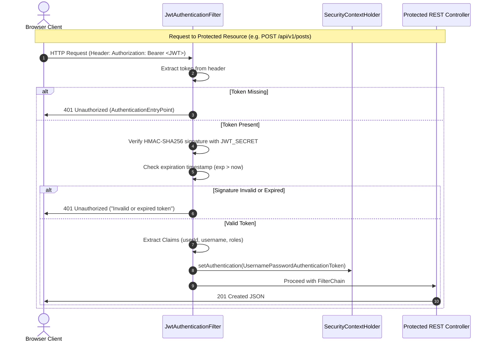

# WriteSpace: Authentication & Security Architecture

> **Security Framework:** Spring Security 6.x / Spring Boot 3.2+  
> **Token Specification:** RFC 7519 JSON Web Token (JJWT 0.12.x)  
> **Hashing Algorithm:** BCrypt (Adaptive Cost Factor: 12)  
> **Status:** Security Hardening Specification

---

## 1. Purpose
This document establishes the security architecture, threat model, authentication mechanisms, authorization policies, and defense-in-depth controls for the **WriteSpace** social publishing platform.

---

## 2. Scope
This specification governs:
- Identity lifecycle (registration, credential validation, stateless session termination).
- Token issuance, signature verification, and claims parsing via JWT.
- Spring Security Filter Chain configuration and request interception.
- Protection against OWASP Top 10 vulnerabilities (SQLi, XSS, CSRF, IDOR, Broken Authentication).
- Secrets management, CORS policies, and transport layer security (TLS).

---

## 3. Technical Explanation: The Threat Model

Because WriteSpace handles user-generated editorial content and user authentication, the system guards against:
1. **Credential Stuffing & Brute Force:** Mitigated by high-work-factor BCrypt hashing and rate-limiting guidelines.
2. **Insecure Direct Object References (IDOR):** Mitigated by verifying resource ownership inside domain services before mutating or deleting articles/comments.
3. **Cross-Site Scripting (XSS):** User-submitted Markdown and text content is stripped of malicious `<script>` and event handler attributes; frontend text rendering defaults to `.textContent`.
4. **SQL Injection (SQLi):** Eliminated through 100% parameterized queries via Spring Data JPA and Hibernate ORM.
5. **Cross-Origin Resource Sharing (CORS) Violations:** Explicit whitelist controls ensure arbitrary third-party origins cannot query private APIs.

---

## 4. Authentication Architecture



### 4.1 Cryptographic Password Storage (BCrypt)
- **Work Factor (Cost):** 12 rounds ($2^{12} = 4,096$ iterations of key expansion).
- **Entropy & Salting:** BCrypt automatically generates a 128-bit cryptographically secure pseudorandom salt per password, stored directly in the resulting modular crypt format string:
  `$2a$12$e8uq...`
- **Constant-Time Verification:** Evaluation against candidate passwords executes in constant time to prevent timing attacks.

### 4.2 JSON Web Token (JWT) Construction
WriteSpace uses stateless compact JWTs signed with HMAC-SHA256 (`HS256`):
- **Secret Key:** 256-bit cryptographic key supplied exclusively via the `JWT_SECRET` environment variable.
- **Claims Schema:**
  - `sub`: User UUID (`subject`)
  - `username`: Author handle
  - `roles`: Assigned roles array (e.g., `["ROLE_USER"]`)
  - `iat`: Issued-at epoch millisecond timestamp
  - `exp`: Expiration epoch millisecond timestamp (default: +24 hours)

---

## 5. Spring Security Filter Chain Configuration

```java
// Conceptual SecurityConfiguration in com.writespace.config.SecurityConfig
@Configuration
@EnableWebSecurity
@EnableMethodSecurity
public class SecurityConfig {

    private final JwtAuthenticationFilter jwtAuthFilter;
    private final AuthenticationEntryPoint unauthorizedHandler;

    @Bean
    public SecurityFilterChain securityFilterChain(HttpSecurity http) throws Exception {
        http
            .csrf(AbstractHttpConfigurer::disable) // Stateless JWT architecture
            .cors(cors -> cors.configurationSource(corsConfigurationSource()))
            .sessionManagement(session -> session.sessionCreationPolicy(SessionCreationPolicy.STATELESS))
            .exceptionHandling(ex -> ex.authenticationEntryPoint(unauthorizedHandler))
            .authorizeHttpRequests(auth -> auth
                // Public Endpoints
                .requestMatchers(HttpMethod.POST, "/api/v1/auth/**").permitAll()
                .requestMatchers(HttpMethod.GET, "/api/v1/posts/**").permitAll()
                .requestMatchers(HttpMethod.GET, "/api/v1/users/**").permitAll()
                .requestMatchers("/swagger-ui/**", "/v3/api-docs/**").permitAll()
                
                // Protected Endpoints
                .requestMatchers(HttpMethod.POST, "/api/v1/posts/**").authenticated()
                .requestMatchers(HttpMethod.PUT, "/api/v1/posts/**").authenticated()
                .requestMatchers(HttpMethod.DELETE, "/api/v1/posts/**").authenticated()
                .requestMatchers("/api/v1/feed").authenticated()
                .requestMatchers("/api/v1/bookmarks/**").authenticated()
                .requestMatchers("/api/v1/users/profile").authenticated()
                
                .anyRequest().authenticated()
            )
            .addFilterBefore(jwtAuthFilter, UsernamePasswordAuthenticationFilter.class);

        return http.build();
    }
}
```

---

## 6. Comprehensive Defense Guidelines

### 6.1 CSRF (Cross-Site Request Forgery) Considerations
- **Decision:** CSRF protection is safely disabled (`csrf.disable()`) in Spring Security.
- **Rationale:** The application uses stateless JWT authentication delivered via the `Authorization: Bearer` HTTP header rather than automatic browser ambient credentials (`cookies`). Because browsers do not automatically attach the `Authorization` header during cross-origin forged requests, CSRF exploits are structurally prevented.

### 6.2 Cross-Origin Resource Sharing (CORS) Policy
- Allowed origins are read strictly from the `FRONTEND_URL` environment variable.
- Wildcards (`*`) are prohibited when credentials or authorization headers are permitted.
- Allowed HTTP methods: `GET`, `POST`, `PUT`, `DELETE`, `OPTIONS`.
- Allowed Headers: `Authorization`, `Content-Type`, `Accept`.
- Max Age: 3600 seconds.

### 6.3 Input Validation & Perimeter Sanitization
- Every request DTO uses Jakarta Bean Validation annotations:
  - `@NotBlank`, `@Size(min = 3, max = 255)`, `@Email`, `@Pattern`.
- Fail-fast perimeter checks reject malformed payloads with HTTP 400 before triggering database operations.

### 6.4 SQL Injection Defense
- 100% of database interactions leverage Spring Data JPA repository abstractions or named JPQL parameters:
  ```java
  // Safe parameterized JPQL query
  @Query("SELECT p FROM Post p WHERE p.author.username = :username AND p.status = :status")
  Page<Post> findByAuthorUsernameAndStatus(
      @Param("username") String username, 
      @Param("status") PostStatus status, 
      Pageable pageable
  );
  ```
- No dynamic SQL string concatenation is ever permitted.

### 6.5 Cross-Site Scripting (XSS) Defense
- **Backend Sanitization:** Article HTML/Markdown bodies pass through an HTML sanitizer (e.g., OWASP Java HTML Sanitizer or Jsoup) upon submission, stripping dangerous tags (`<script>`, `<iframe>`, `onload`, `onerror`).
- **Frontend Safe Binding:** The vanilla JavaScript frontend binds text dynamically via `element.textContent = data.text` rather than assigning untrusted user input directly to `innerHTML`.

### 6.6 Insecure Direct Object Reference (IDOR) Defense
- Verifying the caller's identity against the target resource's author is mandatory prior to performing updates or deletions:
  ```java
  public void deletePost(UUID postId, UUID currentUserId) {
      Post post = postRepository.findById(postId)
          .orElseThrow(() -> new EntityNotFoundException("Post not found"));
      
      if (!post.getAuthor().getId().equals(currentUserId)) {
          throw new AccessDeniedException("Unauthorized: You do not own this post.");
      }
      postRepository.delete(post);
  }
  ```

---

## 7. Secrets Management & Environment Security
- Zero hardcoded credentials in source control.
- `JWT_SECRET`, database passwords, and API keys are provided solely through runtime environment variables.
- Production `.env` files are added to `.gitignore`.

---

## 8. Implementation Guidelines
1. Keep the `JwtAuthenticationFilter` lightweight: resolve user IDs directly from claims rather than making a database query on every static resource filter pass.
2. Ensure `AccessDeniedHandler` and `AuthenticationEntryPoint` return consistent RFC 7807 JSON error responses instead of generic HTML error pages.

---

## 9. Testing Requirements
- Unit tests validating `JwtTokenProvider` expiration parsing and signature tampering detection.
- Security integration tests verifying that unauthenticated requests to `/api/v1/posts` receive HTTP 401.
- Authorization tests verifying that User A cannot delete User B's post (HTTP 403).

---

## 10. Acceptance Criteria
- [ ] Passwords stored in PostgreSQL are cryptographically hashed using BCrypt.
- [ ] Expired or altered JWT tokens are immediately rejected with HTTP 401.
- [ ] Protected endpoints successfully block unauthenticated access.
- [ ] IDOR checks prevent unauthorized modification or deletion across distinct users.
