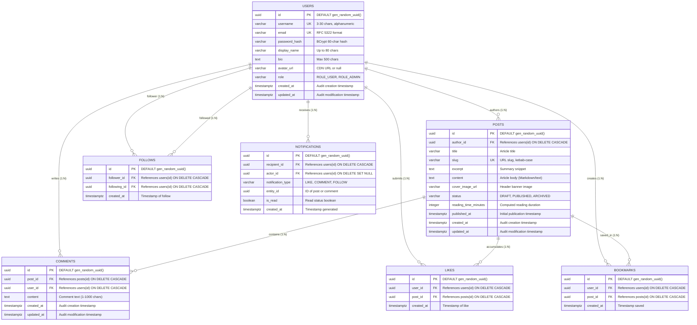

# WriteSpace: Database Architecture & Schema Specification

> **Database Engine:** PostgreSQL 15+ (InsForge Managed)  
> **Migration Engine:** Flyway Core  
> **ORM Layer:** Hibernate 6.x / Spring Data JPA  
> **Status:** Production Specification

---

## 1. Purpose
This document provides the definitive database architecture, relational schema definition, data dictionary, constraint rules, index strategy, and migration management plan for the **WriteSpace** social publishing platform.

---

## 2. Scope
This specification covers:
- Complete relational modeling for core entities (`users`, `posts`, `comments`, `likes`, `follows`, `bookmarks`) and future extensions (`notifications`).
- Column definitions, PostgreSQL data types, primary and foreign key constraints, unique constraints, and check constraints.
- Indexing strategies for high-frequency queries (feeds, lookups, sorting).
- Complete Flyway migration scripts (`V1__init_schema.sql` and `V2__indexes.sql`).
- Relational integrity invariants and cascade delete behaviors.

---

## 3. Technical Explanation & Architecture
WriteSpace utilizes a normalized relational schema hosted on **InsForge Managed PostgreSQL**. Relational databases are chosen over NoSQL stores because social publishing systems inherently model strict relational graphs:
- Content ownership (Users $\rightarrow$ Posts)
- Reader interactions (Users $\times$ Posts $\rightarrow$ Likes, Comments, Bookmarks)
- Social graph topology (Users $\times$ Users $\rightarrow$ Follows)

ACID guarantees ensure that operations like toggling a like or following an author execute atomically without race condition anomalies or orphan records.

---

## 4. Entity-Relationship Diagram (ERD)



---

## 5. Detailed Table Specifications

### 5.1 Table: `users`
**Purpose:** Persists registered user identities, authentication hashes, and profile metadata.

| Column | Type | Nullable | Default | Constraints | Description |
|---|---|---|---|---|---|
| `id` | `UUID` | No | `gen_random_uuid()` | `PRIMARY KEY` | Globally unique user identifier. |
| `username` | `VARCHAR(30)` | No | — | `UNIQUE` | Unique user handle (alphanumeric + underscore). |
| `email` | `VARCHAR(255)` | No | — | `UNIQUE` | Unique email address for login. |
| `password_hash` | `VARCHAR(255)` | No | — | — | BCrypt cryptographic hash ($2a$12$). |
| `display_name` | `VARCHAR(80)` | No | — | — | Public author display name. |
| `bio` | `VARCHAR(500)` | Yes | `NULL` | — | Short author biography. |
| `avatar_url` | `VARCHAR(512)` | Yes | `NULL` | — | Link to user avatar image. |
| `role` | `VARCHAR(20)` | No | `'ROLE_USER'` | `CHECK (role IN ('ROLE_USER', 'ROLE_ADMIN'))` | Security authorization role. |
| `created_at` | `TIMESTAMPTZ` | No | `NOW()` | — | Audit creation timestamp. |
| `updated_at` | `TIMESTAMPTZ` | No | `NOW()` | — | Audit last update timestamp. |

---

### 5.2 Table: `posts`
**Purpose:** Stores long-form articles, drafts, publication metadata, and author links.

| Column | Type | Nullable | Default | Constraints | Description |
|---|---|---|---|---|---|
| `id` | `UUID` | No | `gen_random_uuid()` | `PRIMARY KEY` | Unique article identifier. |
| `author_id` | `UUID` | No | — | `FOREIGN KEY (author_id) REFERENCES users(id) ON DELETE CASCADE` | Creator of the article. |
| `title` | `VARCHAR(255)` | No | — | `CHECK (length(trim(title)) > 0)` | Article headline. |
| `slug` | `VARCHAR(280)` | No | — | `UNIQUE` | Clean URL identifier (e.g., `the-art-of-writing`). |
| `excerpt` | `TEXT` | Yes | `NULL` | — | Short summary snippet for feed cards. |
| `content` | `TEXT` | No | — | — | Full article body text or Markdown. |
| `cover_image_url` | `VARCHAR(512)` | Yes | `NULL` | — | URL of optional header banner image. |
| `status` | `VARCHAR(20)` | No | `'DRAFT'` | `CHECK (status IN ('DRAFT', 'PUBLISHED', 'ARCHIVED'))` | Publication lifecycle state. |
| `reading_time_minutes`| `INTEGER` | No | `1` | `CHECK (reading_time_minutes >= 1)` | Estimated reading time. |
| `published_at` | `TIMESTAMPTZ` | Yes | `NULL` | — | Timestamp of public release. |
| `created_at` | `TIMESTAMPTZ` | No | `NOW()` | — | Creation audit timestamp. |
| `updated_at` | `TIMESTAMPTZ` | No | `NOW()` | — | Last updated timestamp. |

---

### 5.3 Table: `comments`
**Purpose:** Stores reader responses linked to specific articles and users.

| Column | Type | Nullable | Default | Constraints | Description |
|---|---|---|---|---|---|
| `id` | `UUID` | No | `gen_random_uuid()` | `PRIMARY KEY` | Unique comment identifier. |
| `post_id` | `UUID` | No | — | `FOREIGN KEY (post_id) REFERENCES posts(id) ON DELETE CASCADE` | Associated article. |
| `user_id` | `UUID` | No | — | `FOREIGN KEY (user_id) REFERENCES users(id) ON DELETE CASCADE` | Comment author. |
| `content` | `VARCHAR(1000)`| No | — | `CHECK (length(trim(content)) > 0)` | Comment body text. |
| `created_at` | `TIMESTAMPTZ` | No | `NOW()` | — | Creation audit timestamp. |
| `updated_at` | `TIMESTAMPTZ` | No | `NOW()` | — | Last update audit timestamp. |

---

### 5.4 Table: `likes`
**Purpose:** Records reader appreciation for articles.

| Column | Type | Nullable | Default | Constraints | Description |
|---|---|---|---|---|---|
| `id` | `UUID` | No | `gen_random_uuid()` | `PRIMARY KEY` | Unique like identifier. |
| `user_id` | `UUID` | No | — | `FOREIGN KEY (user_id) REFERENCES users(id) ON DELETE CASCADE` | Liking user. |
| `post_id` | `UUID` | No | — | `FOREIGN KEY (post_id) REFERENCES posts(id) ON DELETE CASCADE` | Liked article. |
| `created_at` | `TIMESTAMPTZ` | No | `NOW()` | — | Timestamp when like was recorded. |

> **Constraint:** `CONSTRAINT uq_likes_user_post UNIQUE (user_id, post_id)`  
> *Rule: A user can like a given post only once.*

---

### 5.5 Table: `follows`
**Purpose:** Models the directed social graph between readers and writers.

| Column | Type | Nullable | Default | Constraints | Description |
|---|---|---|---|---|---|
| `id` | `UUID` | No | `gen_random_uuid()` | `PRIMARY KEY` | Unique relationship identifier. |
| `follower_id` | `UUID` | No | — | `FOREIGN KEY (follower_id) REFERENCES users(id) ON DELETE CASCADE` | The user initiating the follow. |
| `following_id` | `UUID` | No | — | `FOREIGN KEY (following_id) REFERENCES users(id) ON DELETE CASCADE` | The writer being followed. |
| `created_at` | `TIMESTAMPTZ` | No | `NOW()` | — | Relationship creation timestamp. |

> **Constraints:**  
> 1. `CONSTRAINT uq_follows_follower_following UNIQUE (follower_id, following_id)`  
>    *Rule: A user cannot follow the same writer multiple times.*  
> 2. `CONSTRAINT chk_follows_no_self_follow CHECK (follower_id <> following_id)`  
>    *Rule: A user cannot follow themselves.*

---

### 5.6 Table: `bookmarks`
**Purpose:** Allows readers to save articles to a private personal library.

| Column | Type | Nullable | Default | Constraints | Description |
|---|---|---|---|---|---|
| `id` | `UUID` | No | `gen_random_uuid()` | `PRIMARY KEY` | Unique bookmark identifier. |
| `user_id` | `UUID` | No | — | `FOREIGN KEY (user_id) REFERENCES users(id) ON DELETE CASCADE` | User saving the post. |
| `post_id` | `UUID` | No | — | `FOREIGN KEY (post_id) REFERENCES posts(id) ON DELETE CASCADE` | Saved article. |
| `created_at` | `TIMESTAMPTZ` | No | `NOW()` | — | Bookmark timestamp. |

> **Constraint:** `CONSTRAINT uq_bookmarks_user_post UNIQUE (user_id, post_id)`  
> *Rule: A user can bookmark an article only once.*

---

### 5.7 Table: `notifications` (Phase 2 / Future)
**Purpose:** Stores user alerts triggered by social events.

| Column | Type | Nullable | Default | Constraints | Description |
|---|---|---|---|---|---|
| `id` | `UUID` | No | `gen_random_uuid()` | `PRIMARY KEY` | Notification identifier. |
| `recipient_id` | `UUID` | No | — | `FOREIGN KEY (recipient_id) REFERENCES users(id) ON DELETE CASCADE` | User receiving alert. |
| `actor_id` | `UUID` | Yes | `NULL` | `FOREIGN KEY (actor_id) REFERENCES users(id) ON DELETE SET NULL` | User who triggered the alert. |
| `notification_type` | `VARCHAR(30)` | No | — | `CHECK (notification_type IN ('LIKE', 'COMMENT', 'FOLLOW'))` | Event category. |
| `entity_id` | `UUID` | Yes | `NULL` | — | ID of related post or comment. |
| `is_read` | `BOOLEAN` | No | `FALSE` | — | Read / unread status flag. |
| `created_at` | `TIMESTAMPTZ` | No | `NOW()` | — | Timestamp of event. |

---

## 6. Complete Flyway Migration Scripts

### 6.1 `V1__init_schema.sql`

```sql
-- =============================================================================
-- Flyway Migration: V1__init_schema.sql
-- Description: Baseline schema creation for WriteSpace platform
-- Author: Senior Database Architect
-- =============================================================================

CREATE EXTENSION IF NOT EXISTS "pgcrypto";

-- 1. USERS TABLE
CREATE TABLE users (
    id UUID PRIMARY KEY DEFAULT gen_random_uuid(),
    username VARCHAR(30) NOT NULL,
    email VARCHAR(255) NOT NULL,
    password_hash VARCHAR(255) NOT NULL,
    display_name VARCHAR(80) NOT NULL,
    bio VARCHAR(500),
    avatar_url VARCHAR(512),
    role VARCHAR(20) NOT NULL DEFAULT 'ROLE_USER',
    created_at TIMESTAMPTZ NOT NULL DEFAULT NOW(),
    updated_at TIMESTAMPTZ NOT NULL DEFAULT NOW(),
    CONSTRAINT uq_users_username UNIQUE (username),
    CONSTRAINT uq_users_email UNIQUE (email),
    CONSTRAINT chk_users_role CHECK (role IN ('ROLE_USER', 'ROLE_ADMIN'))
);

-- 2. POSTS TABLE
CREATE TABLE posts (
    id UUID PRIMARY KEY DEFAULT gen_random_uuid(),
    author_id UUID NOT NULL,
    title VARCHAR(255) NOT NULL,
    slug VARCHAR(280) NOT NULL,
    excerpt TEXT,
    content TEXT NOT NULL,
    cover_image_url VARCHAR(512),
    status VARCHAR(20) NOT NULL DEFAULT 'DRAFT',
    reading_time_minutes INTEGER NOT NULL DEFAULT 1,
    published_at TIMESTAMPTZ,
    created_at TIMESTAMPTZ NOT NULL DEFAULT NOW(),
    updated_at TIMESTAMPTZ NOT NULL DEFAULT NOW(),
    CONSTRAINT fk_posts_author FOREIGN KEY (author_id) REFERENCES users(id) ON DELETE CASCADE,
    CONSTRAINT uq_posts_slug UNIQUE (slug),
    CONSTRAINT chk_posts_status CHECK (status IN ('DRAFT', 'PUBLISHED', 'ARCHIVED')),
    CONSTRAINT chk_posts_title_not_empty CHECK (length(trim(title)) > 0),
    CONSTRAINT chk_posts_reading_time CHECK (reading_time_minutes >= 1)
);

-- 3. COMMENTS TABLE
CREATE TABLE comments (
    id UUID PRIMARY KEY DEFAULT gen_random_uuid(),
    post_id UUID NOT NULL,
    user_id UUID NOT NULL,
    content VARCHAR(1000) NOT NULL,
    created_at TIMESTAMPTZ NOT NULL DEFAULT NOW(),
    updated_at TIMESTAMPTZ NOT NULL DEFAULT NOW(),
    CONSTRAINT fk_comments_post FOREIGN KEY (post_id) REFERENCES posts(id) ON DELETE CASCADE,
    CONSTRAINT fk_comments_user FOREIGN KEY (user_id) REFERENCES users(id) ON DELETE CASCADE,
    CONSTRAINT chk_comments_content_not_empty CHECK (length(trim(content)) > 0)
);

-- 4. LIKES TABLE
CREATE TABLE likes (
    id UUID PRIMARY KEY DEFAULT gen_random_uuid(),
    user_id UUID NOT NULL,
    post_id UUID NOT NULL,
    created_at TIMESTAMPTZ NOT NULL DEFAULT NOW(),
    CONSTRAINT fk_likes_user FOREIGN KEY (user_id) REFERENCES users(id) ON DELETE CASCADE,
    CONSTRAINT fk_likes_post FOREIGN KEY (post_id) REFERENCES posts(id) ON DELETE CASCADE,
    CONSTRAINT uq_likes_user_post UNIQUE (user_id, post_id)
);

-- 5. FOLLOWS TABLE
CREATE TABLE follows (
    id UUID PRIMARY KEY DEFAULT gen_random_uuid(),
    follower_id UUID NOT NULL,
    following_id UUID NOT NULL,
    created_at TIMESTAMPTZ NOT NULL DEFAULT NOW(),
    CONSTRAINT fk_follows_follower FOREIGN KEY (follower_id) REFERENCES users(id) ON DELETE CASCADE,
    CONSTRAINT fk_follows_following FOREIGN KEY (following_id) REFERENCES users(id) ON DELETE CASCADE,
    CONSTRAINT uq_follows_follower_following UNIQUE (follower_id, following_id),
    CONSTRAINT chk_follows_no_self_follow CHECK (follower_id <> following_id)
);

-- 6. BOOKMARKS TABLE
CREATE TABLE bookmarks (
    id UUID PRIMARY KEY DEFAULT gen_random_uuid(),
    user_id UUID NOT NULL,
    post_id UUID NOT NULL,
    created_at TIMESTAMPTZ NOT NULL DEFAULT NOW(),
    CONSTRAINT fk_bookmarks_user FOREIGN KEY (user_id) REFERENCES users(id) ON DELETE CASCADE,
    CONSTRAINT fk_bookmarks_post FOREIGN KEY (post_id) REFERENCES posts(id) ON DELETE CASCADE,
    CONSTRAINT uq_bookmarks_user_post UNIQUE (user_id, post_id)
);
```

---

### 6.2 `V2__add_performance_indexes.sql`

```sql
-- =============================================================================
-- Flyway Migration: V2__add_performance_indexes.sql
-- Description: B-Tree and Composite Indexes for Read/Feed Optimization
-- =============================================================================

-- Indexes on Users
CREATE INDEX idx_users_username_lower ON users (lower(username));
CREATE INDEX idx_users_email_lower ON users (lower(email));

-- Indexes on Posts
CREATE INDEX idx_posts_author_id ON posts (author_id);
CREATE INDEX idx_posts_status_published_at ON posts (status, published_at DESC);
CREATE INDEX idx_posts_slug ON posts (slug);

-- Indexes on Comments
CREATE INDEX idx_comments_post_created ON comments (post_id, created_at ASC);
CREATE INDEX idx_comments_user_id ON comments (user_id);

-- Indexes on Likes
CREATE INDEX idx_likes_post_id ON likes (post_id);
CREATE INDEX idx_likes_user_id ON likes (user_id);

-- Indexes on Follows
CREATE INDEX idx_follows_follower_id ON follows (follower_id);
CREATE INDEX idx_follows_following_id ON follows (following_id);

-- Indexes on Bookmarks
CREATE INDEX idx_bookmarks_user_created ON bookmarks (user_id, created_at DESC);
```

---

## 7. Performance & Index Optimization Strategy

1. **Covering Indexes for Feeds:**
   - The query driving the follower feed filters by `following_id` in `follows` and sorts by `published_at DESC` in `posts`. The composite index `idx_posts_status_published_at` allows index scans without sequential heap reads.
2. **Case-Insensitive Uniqueness:**
   - User lookups query `lower(username)` and `lower(email)` to guarantee case-insensitive login without requiring expensive full-table conversions.
3. **Foreign Key Indexing:**
   - PostgreSQL does not automatically index foreign key columns. By explicitly indexing `post_id`, `user_id`, `author_id`, `follower_id`, and `following_id`, cascade deletions and JOIN operations avoid sequential scans.

---

## 8. Data Migration & Rollback Strategy

- Flyway maintains a schema history table `flyway_schema_history`.
- In local development and staging environments, migration scripts are executed automatically on Spring Boot application boot.
- If a migration fails during deployment:
  - PostgreSQL transaction blocks automatically roll back DDL statements (PostgreSQL supports transactional DDL).
  - The pipeline halts before routing live traffic.
  - A corresponding undo/remedy migration (`V3__fix...sql`) is authored rather than mutating committed version scripts.

---

## 9. Testing Requirements
- Constraint boundary tests:
  - Attempting to insert duplicate `(user_id, post_id)` into `likes` must trigger `DataIntegrityViolationException`.
  - Attempting to insert `follower_id = following_id` into `follows` must trigger check constraint violation.
  - Deleting an author must cascade and delete all associated articles, comments, and likes.

---

## 10. Acceptance Criteria
- [ ] Flyway executes `V1` and `V2` scripts cleanly against InsForge PostgreSQL with zero warnings.
- [ ] All table primary keys use UUIDs generated via `gen_random_uuid()`.
- [ ] Unique constraints and check constraints correctly reject invalid data.
- [ ] JPA entities cleanly map to these table schemas with `spring.jpa.hibernate.ddl-auto=validate`.
