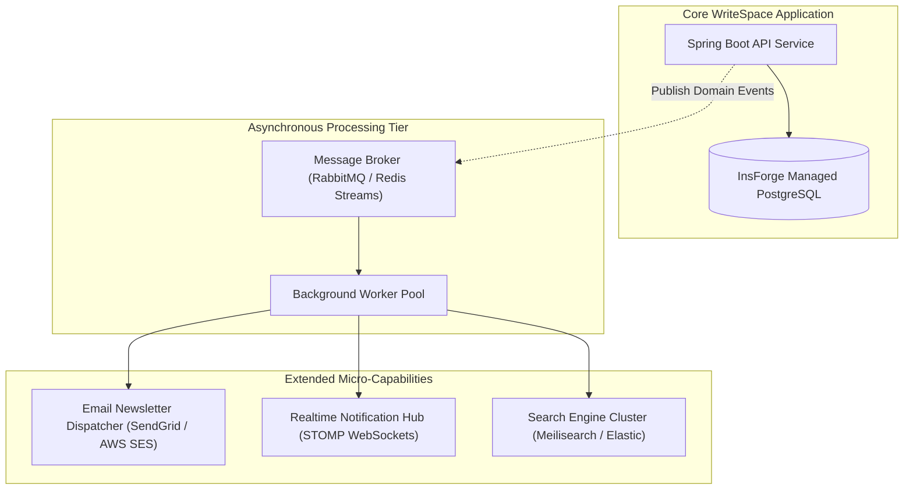

# WriteSpace: Future Enhancements & Long-Term Roadmap

> **Document Version:** 1.0.0  
> **Classification:** Product Strategy & Architectural Evolution  
> **Status:** Strategic Roadmap

---

## 1. Purpose
This document provides the technical vision, architectural designs, and implementation strategies for post-MVP enhancements to the **WriteSpace** platform. It outlines how the system can evolve into a full-scale publishing network with newsletters, monetization, real-time engagement, search clusters, and analytical dashboards.

---

## 2. Scope
This specification covers 12 advanced platform capabilities:
1. Direct Newsletter Subscriptions
2. Outbound Email Notifications
3. Real-Time In-App Notifications (WebSocket / SSE)
4. Trending & Algorithmic Discovery
5. Advanced Full-Text Search (Elasticsearch / Meilisearch)
6. Rich WYSIWYG Block Editor (TipTap / ProseMirror)
7. Dynamic Reading Time & Scroll Velocity Tracking
8. Writer Analytics Dashboard
9. Reader Engagement & Read-Completion Metrics
10. Administrative Moderation Suite & Role-Based RBAC
11. Content Recommendation Engine
12. Native Social Sharing & OpenGraph Previews

---

## 3. High-Level Future Architecture Evolution

---

## 4. Detailed Future Capability Specifications

### 4.1 Direct Newsletter Subscriptions
- **Concept:** Allow readers to subscribe directly to a writer's publication using their email address.
- **Workflow:** When an author publishes a post with "Send as Newsletter" enabled, an asynchronous domain event triggers an email delivery queue dispatching formatted HTML articles to all verified subscribers.
- **Tech Stack:** Spring Boot `@Async`, Redis Streams / RabbitMQ, AWS SES or Resend API.

---

### 4.2 Outbound Email Notifications
- **Concept:** Automated transactional emails for core events:
  - Welcome email upon registration.
  - New follower notification.
  - New comment notification on author's post.
  - Weekly digest of top stories from followed writers.
- **Implementation:** Thymeleaf HTML email templates rendered server-side and dispatched asynchronously.

---

### 4.3 Real-Time In-App Notifications
- **Concept:** Instant UI badges and dropdown alerts when another user likes a post, leaves a comment, or follows an author.
- **Architecture:** 
  - Server-Sent Events (SSE) or STOMP over WebSocket (`spring-boot-starter-websocket`).
  - Active browser sessions maintain a persistent duplex connection, receiving instant JSON push notifications.

---

### 4.4 Trending & Velocity Discovery
- **Concept:** An algorithmic explore feed highlighting articles generating unusual momentum.
- **Algorithm (Hacker News / Reddit Gravity Formula):**
  $$\text{Score} = \frac{\text{Likes} \times 2 + \text{Comments} \times 3}{(\text{Hours Since Publication} + 2)^{1.5}}$$
- **Optimization:** Calculated via scheduled background tasks (Spring `@Scheduled`) and cached in Redis.

---

### 4.5 Advanced Full-Text Search
- **Concept:** High-speed fuzzy search, autocomplete suggestions, and typo-tolerant search across millions of articles and authors.
- **Evolution:**
  - Transition from PostgreSQL `ILIKE` queries to PostgreSQL native `tsvector` with GIN indexing.
  - At scale ($> 100,000$ articles), integrate **Meilisearch** or **Elasticsearch** synchronized via Debezium Change Data Capture (CDC).

---

### 4.6 Rich WYSIWYG Block Editor
- **Concept:** Upgrade the plain-text/Markdown textarea to a modular block-based editor inspired by Notion or Substack.
- **Tech Candidates:** TipTap, ProseMirror, or Editor.js.
- **Features:** Inline drag-and-drop image uploads, syntax-highlighted code blocks, embedded YouTube/Twitter widgets, and table formatting.

---

### 4.7 Reading Time & Scroll Velocity Tracking
- **Concept:** Client-side beacon tracking reader scroll depth to measure actual article completion rates (e.g., whether readers finished the essay or bounced after the first 2 paragraphs).
- **Tech Stack:** `IntersectionObserver` API + `Navigator.sendBeacon()` dispatching analytics metrics without blocking page unload.

---

### 4.8 Writer Analytics Dashboard
- **Concept:** A private portal (`/dashboard/analytics.html`) providing writers with actionable audience insights:
  - Total impressions and unique visitors.
  - Follower growth trajectories over 30/90 days.
  - Top traffic referrers (Search, Direct, Social).
  - Reader engagement depth.

---

### 4.9 Administrative Moderation Suite
- **Concept:** An enterprise admin dashboard for platform stewards:
  - User suspension and ban management.
  - Flagged comment and post review queue.
  - Audit logging of administrative actions.
- **Security:** Guarded by `ROLE_ADMIN` and method-level security (`@PreAuthorize("hasRole('ADMIN')")`).

---

### 4.10 Content Recommendation Engine
- **Concept:** "More from this author" and "Related articles" widgets at the footer of each article.
- **Approach:**
  - Phase 1: Tag-based co-occurrence matching in PostgreSQL.
  - Phase 2: Vector embeddings (pgvector) computing cosine similarity between article semantic vectors.

---

### 4.11 Monetization & Paid Subscriptions
- **Concept:** Enable authors to offer paid tiers ($5/month or $50/year) for exclusive subscriber-only essays.
- **Tech Stack:** Stripe Checkout and Stripe Webhooks. Posts maintain an access tier attribute (`FREE`, `PAID_MEMBERS_ONLY`).

---

### 4.12 Native Social Sharing & OpenGraph Previews
- **Concept:** Generate rich social preview cards when articles are shared on X, LinkedIn, or messaging platforms.
- **Implementation:** Backend endpoint `/posts/{slug}/og-image` dynamically generates a 1200x630 PNG card displaying title, author avatar, and publication branding.

---

## 5. Architectural Guidelines for Future Work
- Maintain strict modularity: ensure extensions consume standard domain events rather than embedding vendor-specific logic into core CRUD services.
- Never compromise core read performance ($< 200\text{ ms}$) to run heavy analytical calculations synchronously.

---

## 6. Testing Requirements
- Asynchronous tasks must be verified with isolated mock queues.
- Integration tests for webhooks must use mock signature payloads.

---

## 7. Acceptance Criteria
- [ ] Enhancements integrate seamlessly into the core layered architecture.
- [ ] Database migrations adhere to Flyway versioning rules without altering existing table semantics.
