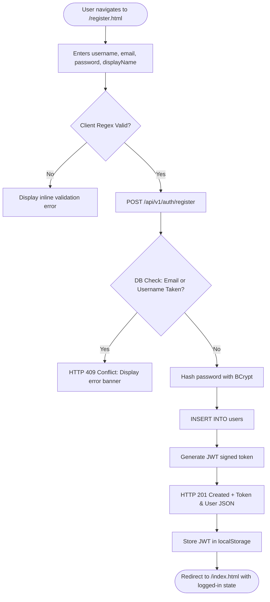

# WriteSpace: User Journey & Workflow Specifications

> **Document Version:** 1.0.0  
> **Classification:** Interaction Design & User Journey Specification  
> **Status:** Implementation Baseline Specification

---

## 1. Purpose
This document specifies the exact step-by-step user workflows for all primary interactions within the **WriteSpace** platform. It establishes the sequential steps, system decisions, input validation rules, state transitions, and Mermaid flowcharts governing both reader and writer journeys.

---

## 2. Scope
This document specifies 13 core workflows:
1. User Registration Workflow
2. User Login Workflow
3. Profile Initialization Workflow
4. Profile Editing Workflow
5. Article Composition & Publishing Workflow
6. Article Editing Workflow
7. Article Deletion Workflow
8. Like / Unlike Workflow
9. Comment Submission & Deletion Workflow
10. Follow / Unfollow Author Workflow
11. Reading Feed (Explore vs. Following) Workflow
12. Article Search & Filtering Workflow
13. Article Bookmarking Workflow

---

## 3. Technical Explanation: Workflow Architecture

Each workflow is modeled through a standardized lifecycle:
1. **Trigger:** The initiating user action in the browser.
2. **Client Validation:** Pre-submission perimeter validation.
3. **Network Exchange:** HTTP payload dispatched via the Fetch API.
4. **Backend Processing:** Authorization checks, business validations, transactions.
5. **Persistence Mutation:** PostgreSQL ACID transaction execution.
6. **State Reconciliation:** UI updates, cache updates, or URL redirections.

---

## 4. Authentication Workflows

### 4.1 User Registration Workflow


- **Step 1:** User visits `register.html` and fills out username, email, password, and display name.
- **Step 2:** Client validates password strength ($\ge 8$ chars, digits, symbols) and email format.
- **Step 3:** Client sends `POST /api/v1/auth/register`.
- **Step 4:** Backend validates uniqueness. If duplicate, returns 409 Conflict.
- **Step 5:** Password hashed via BCrypt (cost factor 12); user saved in PostgreSQL.
- **Step 6:** JWT token returned; client saves token in `localStorage` and updates global navigation header.

---

### 4.2 User Login Workflow
- **Step 1:** User visits `login.html`, enters email and password, and clicks "Sign In".
- **Step 2:** Client dispatches `POST /api/v1/auth/login`.
- **Step 3:** Spring Security loads user record, compares BCrypt hash.
- **Step 4:** On failure: returns HTTP 401 Unauthorized ("Invalid credentials").
- **Step 5:** On success: returns HTTP 200 with JWT token and user profile summary.
- **Step 6:** Frontend stores token and navigates user to target destination or `/feed.html`.

---

## 5. Profile Management Workflows

### 5.1 Profile Editing Workflow
- **Step 1:** Authenticated user navigates to their profile page and clicks "Edit Profile".
- **Step 2:** A modal or settings view opens pre-filled with current display name, bio, and avatar URL.
- **Step 3:** User modifies bio ($\le 500$ characters) and display name.
- **Step 4:** Client issues `PUT /api/v1/users/profile` with Bearer token.
- **Step 5:** Backend updates PostgreSQL `users` table and returns updated DTO.
- **Step 6:** Client updates cached user profile in `localStorage` and reflects new bio on screen.

---

## 6. Article Publishing Workflows

### 6.1 Article Publishing Workflow
```mermaid
flowchart TD
    A([Author opens /editor.html]) --> B{User Logged In?}
    B -- No --> C[Redirect to /login.html]
    B -- Yes --> D[Author composes title, excerpt, content, tags]
    D --> E[User clicks 'Publish']
    E --> F{Title & Content Non-Empty?}
    F -- No --> G[Show toast: Title and content required]
    F -- Yes --> H[POST /api/v1/posts with status: PUBLISHED]
    H --> I[Backend verifies JWT principal]
    I --> J[Generate slug & calculate reading time]
    J --> K[INSERT INTO posts status=PUBLISHED, published_at=NOW()]
    K --> L[HTTP 201 Created + Article JSON]
    L --> M([Redirect browser to /article.html?slug=...])
```

- **Step 1:** Authenticated writer opens `editor.html`.
- **Step 2:** Writer inputs article title, excerpt, and body text.
- **Step 3:** Writer selects "Publish" (or "Save Draft").
- **Step 4:** Client dispatches `POST /api/v1/posts`.
- **Step 5:** Backend verifies JWT, derives URL slug, estimates read time, and commits transaction.
- **Step 6:** On HTTP 201 response, client navigates directly to published article view.

---

### 6.2 Article Editing Workflow
- **Step 1:** Author views own published post, clicks "Edit Article".
- **Step 2:** Editor loads existing content from `GET /api/v1/posts/{slug}`.
- **Step 3:** Author updates content and clicks "Save Changes".
- **Step 4:** Client sends `PUT /api/v1/posts/{id}`.
- **Step 5:** Backend confirms `author_id == authenticated_user_id` (rejects with 403 if mismatch).
- **Step 6:** PostgreSQL row updated; author redirected to updated article.

---

### 6.3 Article Deletion Workflow
- **Step 1:** Author clicks "Delete Article" button on article settings menu.
- **Step 2:** Browser prompts confirmation dialog: "Are you sure you want to delete this article? This action cannot be undone."
- **Step 3:** Upon confirmation, client sends `DELETE /api/v1/posts/{id}`.
- **Step 4:** Backend validates ownership; executes cascade deletion in PostgreSQL (removes post, likes, comments, bookmarks).
- **Step 5:** Client receives HTTP 204 No Content; displays success toast; redirects to `/profile.html`.

---

## 7. Social Interaction Workflows

### 7.1 Like / Unlike Article Workflow
```mermaid
flowchart LR
    A[Reader clicks Heart button] --> B{Authenticated?}
    B -- No --> C[Prompt Sign In Toast]
    B -- Yes --> D[POST /api/v1/posts/{id}/like]
    D --> E{Already Liked?}
    E -- No --> F[INSERT INTO likes]
    E -- Yes --> G[DELETE FROM likes]
    F --> H[Return liked: true, count: N+1]
    G --> I[Return liked: false, count: N-1]
    H & I --> J[Update UI button state & counter]
```

---

### 7.2 Comment Submission Workflow
- **Step 1:** Reader scrolls to article discussion thread on `article.html`.
- **Step 2:** Reader enters comment text in `<textarea>` and clicks "Post Comment".
- **Step 3:** Client validates comment is non-empty and $\le 1000$ characters.
- **Step 4:** Issues `POST /api/v1/posts/{postId}/comments` with JWT.
- **Step 5:** Backend sanitizes text, inserts into `comments`, and returns populated `CommentResponseDTO`.
- **Step 6:** Client prepends new comment DOM element to the comment list with animation.

---

### 7.3 Follow / Unfollow Author Workflow
- **Step 1:** Reader views author profile or article header card, clicks "Follow".
- **Step 2:** Client dispatches `POST /api/v1/users/{authorId}/follow`.
- **Step 3:** Backend verifies reader is not targeting their own user ID (`follower_id <> following_id`).
- **Step 4:** Inserts or removes row from `follows` table.
- **Step 5:** Client receives updated `{ following: boolean, followersCount: number }`.
- **Step 6:** UI toggles button appearance ("Follow" $\leftrightarrow$ "Following") and increments/decrements follower count.

---

### 7.4 Article Bookmarking Workflow
- **Step 1:** Reader clicks Bookmark icon on article card or reader view.
- **Step 2:** Client dispatches `POST /api/v1/posts/{id}/bookmark`.
- **Step 3:** Backend creates or deletes relation in `bookmarks` table.
- **Step 4:** Client toggles bookmark icon styling (filled vs. outline).
- **Step 5:** Article immediately appears in reader's `/bookmarks.html` list.

---

## 8. Feed Discovery & Search Workflows

### 8.1 Following Feed Retrieval Workflow
- **Step 1:** Authenticated user navigates to `/feed.html`.
- **Step 2:** Client calls `GET /api/v1/feed?page=0&size=10`.
- **Step 3:** Backend queries published articles authored by accounts present in user's follow list.
- **Step 4:** If user follows authors with posts, renders article feed. If user follows no one, displays an empty-state card recommending popular writers to follow.

---

### 8.2 Keyword Search & Tag Filtering Workflow
- **Step 1:** User enters search term into navigation search input (or clicks topic tag like `#architecture`).
- **Step 2:** Client navigates to `/index.html?q=architecture` or updates feed asynchronously.
- **Step 3:** Issues `GET /api/v1/posts?q=architecture`.
- **Step 4:** Backend runs matching query against titles and excerpts.
- **Step 5:** Returns matching post cards with pagination controls.

---

## 9. Testing Requirements
- Test each workflow against happy path and failure branches (network drop, expired JWT, invalid parameters).
- Validate correct redirection for all authenticated routes when accessed anonymously.

---

## 10. Acceptance Criteria
- [ ] All 13 workflows execute smoothly from start to finish.
- [ ] UI provides immediate visual feedback (loading spinners, disabled buttons, toast notifications) during network transit.
- [ ] No unhandled JavaScript exceptions occur during any user journey.
